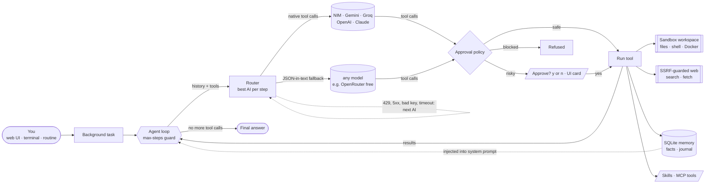

<div align="center">

# 🤖 AutoMoto AI

### Your AI cousin — an agent that actually *does* the work.

Give it a goal. It picks the best free AI, searches the web, reads and writes files in its own
sandbox, runs commands **after you approve**, remembers what matters, and keeps going until the
job is done. If one AI is rate-limited or down, the next one carries on mid-task.

[](CHANGELOG.md)
[](https://github.com/ymmiah/AutoMotoAI/actions)
[](LICENSE)


</div>

---

## ✨ What it can do

- **🖥 Feel like a real app.** A full chat app at `python -m automoto serve` (and inside the desktop shell): saved conversations, live tool-step cards, inline approvals, image attach, Memory / Routines / Skills / Tasks / Tools / Settings pages, dark and light themes, a command palette and a layout that works on a phone. [See the GUI](#-the-app).

- **🛠 Work like an agent, not a chat box.** It plans, calls tools, reads the results and repeats until the goal is met (with a step limit so it can't loop forever).
- **🔀 Use every AI you have a key for.** NVIDIA NIM, Gemini, Groq, OpenRouter (free tiers) plus OpenAI and Claude. It picks the best one for each step and **fails over mid-task** on rate limits, 5xx errors, bad keys or timeouts.
- **👁 Know which AIs can see.** Screenshots and photos only go to vision-capable models.
- **🔎 Research with sources.** Free web search (DuckDuckGo, no key) and page fetching behind an SSRF guard.
- **📁 Have its own little computer.** Files and shell commands are jailed to a sandbox workspace, with an optional throwaway Docker container.
- **✋ Ask before anything risky.** Shell commands, writes outside `scratch/`, desktop actions and deleting memories wait for **Approve / Deny** in the web UI or **y/n** in the terminal. Destructive commands are blocked outright.
- **🧠 Remember you.** SQLite memory of facts about you and your projects plus a dated journal, fed into every run.
- **📚 Follow skills.** Drop a `SKILL.md` into `~/.automoto/skills/` and it will load and follow it when a task matches.
- **⏰ Run routines.** "Every weekday at 8:00, check the news on X and summarise it", on an interval or cron schedule, while the server is up.
- **🧵 Run in the background.** Every agent run is a background task, so the chat stays responsive and you can stop a task from the panel.
- **🔌 Connect MCP servers.** Optional stdio MCP client exposes external tools, which need approval unless you trust them.

---

## 🧭 How it works



Every step goes back through the router, so if NIM rate-limits you on step 4, Groq or Gemini
picks up the same history on step 5. The agent keeps one provider-neutral history and renders
it per provider (OpenAI tool messages, Claude `tool_use` blocks, or plain text for models
without native tool calling).

---

## 🖥 The app

`python -m automoto serve` opens a full app in your browser (the Tauri desktop shell shows the same one).
Everything ships inside the Python package, with no build step and no CDN: the libraries are vendored and the page runs under a strict Content-Security-Policy (`script-src 'self'`, no inline scripts).

<div align="center">

&nbsp;

</div>

- **💬 Chats that stick around.** Every conversation is saved in SQLite (`~/.automoto/conversations.db`) and listed in the sidebar by Today / Yesterday / Previous 7 days / Older. You can search titles and message text, rename and delete. Titles come from your first message.
- **⚡ Agent or 💭 Chat.** Use the toggle to switch: **Agent** uses tools step by step, **Chat** gives a plain answer. The provider picker defaults to **Auto** and the footer of every answer shows which AI answered, the model, the step count and any failovers.
- **🧩 Live steps.** Each tool call is a collapsible card with an icon, its arguments, the result and its timing. Risky calls show an inline **Approve / Deny** card (keys **A** / **D**). **Stop** cancels between steps or while a run waits for approval. Runs keep going in the background if you switch chats, and the sidebar marks running chats.
- **🖼 Images.** Paste, drag and drop, or use the 📎 button (up to 4 per message). Big photos are shrunk in the browser first, and images only go to vision-capable models.
- **📝 Nice answers.** Markdown rendering (sanitised with DOMPurify), syntax-highlighted code blocks with copy buttons, and a copy button on every answer.
- **📄 Pages.**
  - **Memory:** add, filter and forget facts, plus a journal timeline.
  - **Routines:** create, edit, pause or resume, run now, delete, and see the last result.
  - **Skills:** browse, view, create and edit `SKILL.md` files. Bundled skills are read-only; **Customise** makes your own copy.
  - **Tasks:** every run, live, with a stop button.
  - **Tools:** every tool with a safe / risky / blocked badge.
  - **Settings:** theme (dark, light or system), accent colour, approval mode, default mode, provider order, and bring-your-own keys.
- **🔑 Keys stay in the tab.** BYOK keys live in `sessionStorage` only. They are sent with each request, never saved on the server (the settings API rejects anything that looks like a key), and they are wiped when you close the tab.
- **⌨ Keyboard.**
  - <kbd>Ctrl/⌘ K</kbd>: command palette (commands and chats)
  - <kbd>Ctrl/⌘ N</kbd>: new chat. Chrome keeps Ctrl+N for itself, so use <kbd>Ctrl/⌘ Shift O</kbd> there.
  - <kbd>Ctrl/⌘ B</kbd>: toggle the sidebar
  - <kbd>Enter</kbd> sends, <kbd>Shift Enter</kbd> adds a new line
  - <kbd>Esc</kbd> stops a run or closes a dialog
- **♿ Accessible and responsive.** Built with landmarks, ARIA labels, a live region for the chat, visible focus rings and a skip link, and it honours `prefers-reduced-motion`. Below 760 px wide the sidebar slides in from the side.

---

## 🚀 Quick start

```bash
pip install -r requirements.txt
cp .env.example .env            # add at least one key, e.g. NVIDIA_API_KEY (free: build.nvidia.com)
python -m automoto serve        # → http://127.0.0.1:8765
```

On Windows use `copy .env.example .env`. You can also run `./setup.sh` / `setup.bat` and then `./run.sh` / `run.bat`.

More ways to use it:

```bash
python -m automoto                         # agent chat in the terminal (approvals as y/n)
python -m automoto do "Find the 3 newest NVIDIA NIM models and save a summary to scratch/nim.md"
python -m automoto do "What does this error mean?" --image screenshot.png
python -m automoto --plain                 # plain chat, no tools (v4 behaviour)
python -m automoto status                  # which AIs are ready + vision matrix
python -m automoto tools                   # every tool and its safety level
python -m automoto memory add "I prefer concise answers"
python -m automoto routines add news --cron "0 8 * * 1-5" --prompt "Search the web for AI news and give me 5 bullets with links"
```

---

## 👁 Providers, vision & tool calling

Every model can be overridden in `.env` (`NIM_MODEL`, `NIM_AGENT_MODEL`, `GROQ_VISION_MODEL`, and so on).

| Provider | Key | Free tier | Vision | Agent tool calling | Agent model (first try) | Vision model |
|---|---|---|---|---|---|---|
| **NVIDIA NIM** | `NVIDIA_API_KEY` | ✅ | ✅ | native ✅ *(live-tested)* | `nvidia/nemotron-3.5-super-vl-120b-a12b` | `meta/llama-3.2-11b-vision-instruct` |
| **Google Gemini** | `GEMINI_API_KEY` | ✅ | ✅ | native (OpenAI-compatible endpoint) | `gemini-flash-latest` | `gemini-flash-latest` |
| **Groq** | `GROQ_API_KEY` | ✅ | ✅ (preview) | native | `openai/gpt-oss-120b` | `qwen/qwen3.8-27b` |
| **OpenRouter** | `OPENROUTER_API_KEY` | ✅ `:free` | ✅ | JSON-in-text fallback | `openrouter/free` | `google/gemma-4-31b-it:free` |
| **OpenAI** | `OPENAI_API_KEY` | paid | ✅ | native | `gpt-5.4-mini` | `gpt-5.4-mini` |
| **Anthropic Claude** | `ANTHROPIC_API_KEY` | paid | ✅ | native (`tool_use`) | `claude-haiku-4-5` | `claude-haiku-4-5` |

- If a native tool call is rejected (400/404/422), the same model is retried with the text protocol before AutoMoto moves to the next provider. Set `AUTOMOTO_TOOL_MODE=text` to force the text protocol.
- A provider whose key is rejected (401/403) is skipped for the rest of that run.
- How it picks: images go to the strongest vision model, code and deep reasoning go to the strongest model, and quick chat goes to the fastest. Your `--prefer` / `AI_PROVIDER` choice always goes first.

---

## 🧰 Tools

| Tool | Safety | What it does |
|---|---|---|
| `list_dir`, `read_file` | 🟢 safe | Read inside the sandbox workspace |
| `write_file` | 🟢 safe in `scratch/` · 🟠 risky elsewhere | Create, overwrite or append a text file in the workspace |
| `run_shell` | 🟠 risky · 🔴 blocked if destructive | Command runs in the workspace (Docker if available), with timeout and secrets stripped |
| `web_search` | 🟢 safe | DuckDuckGo HTML search, no API key |
| `fetch_url` | 🟢 safe | GET a public page or API through the SSRF guard |
| `remember`, `recall` | 🟢 safe | Long-term memory |
| `forget` | 🟠 risky | Delete one memory |
| `load_skill` | 🟢 safe | Load a skill's full instructions |
| `system_info` | 🟢 safe | OS and runtime |
| `open_url`, `open_app`, `type_text`, `hotkey` | 🟠 risky | Desktop actions, only for clients on the same computer |
| `mcp__<server>__<tool>` | 🟠 risky (🟢 if `"trust": true`) | Tools from your MCP servers |

🔴 **Always blocked:** paths outside the workspace, `sudo`, `mkfs`, `dd of=`, `shutdown`/`reboot`, `curl … | sh`,
and destructive commands (`rm`, `del`, `mv`, `chmod` …) that point at `~`, `..`, `$HOME` or absolute paths.
There is no tool that can delete anything outside the sandbox.

**Approval modes** (`.env`): `AUTOMOTO_APPROVAL=ask` (default) · `auto` (approve risky calls; only use this inside Docker) ·
`readonly` (deny every risky call). Fine-tune with `AUTOMOTO_AUTO_APPROVE=write_file` and `AUTOMOTO_BLOCK_TOOLS=open_app`.

---

## 🧠 Memory, 📚 skills, ⏰ routines, 🔌 MCP

Everything lives in `~/.automoto/` (override with `AUTOMOTO_DATA_DIR`):

```
~/.automoto/
  workspace/        the sandbox (scratch/ inside needs no approval)
  memory.db         SQLite: facts + dated journal
  skills/<name>/SKILL.md
  routines.json     schedules · routines.log = results
  mcp.json          optional MCP servers
```

**Skills** are folders with a `SKILL.md` (front matter `name` and `description`, then the steps). Only names
and descriptions go into the prompt, and the agent calls `load_skill` when one fits. Four ship with
AutoMoto: `research-brief`, `repo-health-check`, `project-scaffold` and `write-a-skill`.

**Routines** run while `python -m automoto serve` is up. Schedules can be `every 30m`, `every 2h` or `every 1d`
(the first run is due straight away), or a 5-field cron such as `0 8 * * 1-5` in local time. They run unattended, so
risky tools are **auto-denied** unless you allow them in `AUTOMOTO_AUTO_APPROVE`. You can manage them from the CLI or the web panel.

**MCP** (stdio servers only):

```json
{ "servers": {
    "fs": { "command": "npx", "args": ["-y", "@modelcontextprotocol/server-filesystem", "/some/folder"], "trust": false }
} }
```

---

## 🔒 Security model

| Layer | What protects you |
|---|---|
| **BYOK keys** | No keys in the repo, and `.env` is git-ignored. Keys typed in the web UI live in `sessionStorage` (wiped when you close the tab) and are sent only to your local server for that request or task. They are never stored, logged, or echoed in task events (tests enforce this). |
| **Local server** | Binds `127.0.0.1`. A per-launch session token stops other websites from driving the API, and network binding is refused without `AUTOMOTO_API_TOKEN`. |
| **Sandbox** | All file and shell tools are jailed to the workspace (symlink-safe). Shell commands get secret-free env vars, a timeout and a process-tree kill. Docker mode adds `--network none` plus memory, CPU and PID limits. |
| **Approvals** | safe, risky or blocked for every call. Risky calls wait for you, and blocked calls can never be approved. |
| **SSRF guard** | `fetch_url` and `web_search` refuse private, loopback, link-local, CGNAT and reserved ranges, *including* IPv4-mapped IPv6 (`::ffff:127.0.0.1`), NAT64, 6to4 and Teredo. Connections are pinned to the checked IP and redirects are re-checked. Public IPv4 such as `148.135.128.60` stays allowed. |

Full details and honest limits are in [SECURITY.md](SECURITY.md).

---

## 🔗 HTTP API

| Endpoint | What |
|---|---|
| `POST /api/agent` | Start an agent task: `{messages, prefer?, keys?, max_steps?}`, or `{conversation_id, message, …}` to continue a saved chat (the answer is saved when the run ends) → `{task_id, conversation_id}` |
| `GET/POST /api/conversations?q=` · `GET/PATCH/DELETE /api/conversations/{id}` | Saved chats: list or search, create, read with messages, rename or change mode, delete |
| `POST /api/conversations/chat` | Plain (no tools) turn in a saved chat: `{conversation_id, message, prefer?, keys?}` |
| `GET/PUT /api/settings` | Theme, accent, default mode, approval mode, provider order (PUT only from this computer; keys are rejected) |
| `GET /api/skills` · `GET/PUT/DELETE /api/skills/{name}` | List, read, save and delete user skills (writes only from this computer) |
| `GET /api/tasks` · `GET /api/tasks/{id}?since=n` | Task list, and a task's status plus new events (steps, tool calls, results, approvals) |
| `POST /api/tasks/{id}/approve` · `/cancel` | `{call_id, approve}`, or stop the task |
| `GET/POST /api/memory` · `DELETE /api/memory/{id}` | Memory facts and journal |
| `GET/POST /api/routines` · `PATCH/DELETE /api/routines/{name}` · `POST …/{name}/run` | Routines (PATCH changes the schedule or prompt, or pauses or resumes) |
| `GET /api/agent/info` | Tools with safety levels, skills, sandbox and approval mode |
| `POST /api/chat` · `GET/POST /api/status` · `POST /api/recommend` | v4 plain chat and provider status |

Interactive docs are at `/api/docs` while the server runs.

---

## 🗺 Status & roadmap

| Part | Status |
|---|---|
| Agent loop, router with mid-task failover, tools, approvals, memory, skills, routines, background tasks | ✅ Working. Unit-tested and live-tested on NVIDIA NIM (native and text tool modes, vision, web search, approvals, a routine run) |
| Web app (v5.1): saved chats, agent and chat modes, approvals, images, all pages, themes, mobile layout | ✅ Working. Tested end-to-end in headless Chrome against NVIDIA NIM at desktop and phone widths |
| Native tool calling on Gemini, Groq, OpenAI and Claude | 🟡 Implemented and unit-tested with fakes, not yet live-tested |
| Docker sandbox runner | 🟡 Implemented, not yet tested on a machine with Docker. Falls back to the local sandbox |
| MCP client (stdio) | 🟡 Working against a test server. Remote (HTTP) MCP is not supported |
| Desktop app: Tauri 2 shell for Windows, macOS and Linux (`apps/desktop`) | 🧱 Scaffold. Wraps the same web UI, so agent mode comes along. Build locally with Rust + Tauri |
| Mobile app: Flutter for Android and iOS (`apps/mobile`) | 🧱 Scaffold. Still uses the plain-chat API (agent mode on mobile is next). iOS needs Xcode |
| Browser automation (Playwright tool) | ⏭ Planned. Left out rather than shipped half-working |
| Remote MCP, streaming tokens, per-routine approval rules | ⏭ Planned |

---

## 🧪 Tests

```bash
pip install -r requirements-dev.txt
python -m pytest -q          # 112 tests, no keys and no network needed
```

The tests cover: the agent loop (native, text fallback, native→text retry, mid-loop failover, bad-key skip, max steps, approvals, blocked calls), the sandbox path jail and symlink escapes, the shell timeout, policy modes, the SSRF guard (mapped/NAT64/6to4 cases), memory, skills, cron and interval scheduling, background-task approvals and cancel, the MCP stdio client, the API (including saved conversations, settings, skill editing, routine editing, and the GUI's static files and CSP), and the v4 router. CI runs on Windows, macOS and Linux with Python 3.10 and 3.13.

## 🗂 Layout

```
automoto/
  loop.py        agent loop (steps, approvals, max-steps guard)
  router.py      ask() + ask_turn(): best AI per step, auto-failover, vision routing
  providers.py   provider registry + transports (OpenAI-compatible, Anthropic)
  toolcalls.py   neutral history ⇄ OpenAI / Claude / text tool-call formats
  tools.py       the toolbox · policy.py approvals · sandbox.py workspace jail + Docker
  netguard.py    SSRF guard + pinned HTTP client
  memory.py      SQLite memory · skills.py SKILL.md loader · routines.py scheduler
  tasks.py       background tasks · mcp.py stdio MCP client
  conversations.py saved chats (SQLite) · settings.py GUI settings (no secrets)
  server.py      FastAPI API + web UI · cli.py terminal · desktop.py OS actions
  web/           index.html + static/ (app.js, app.css, icons, vendored marked / DOMPurify / highlight.js)
  skills_bundled/ example skills
apps/desktop     Tauri 2 shell · apps/mobile Flutter app · tests/ pytest
```

---

<div align="center">

### 👤 Built by

**Yasin Mohammed Miah**, Student of BCU, BSc Computing Top-Up (Hons)

[](https://github.com/ymmiah)
[](https://linkedin.com/in/ymmiah)
[](https://ymmiah.com)

More projects: [GhostWires](https://github.com/ymmiah/GhostWires) (OSINT recon, [live](https://ghostwires.onrender.com)) · [AegisSec](https://github.com/ymmiah/AegisSec) (security problem registry)

MIT licensed ([LICENSE](LICENSE)) · Contributions welcome ([CONTRIBUTING.md](CONTRIBUTING.md))

</div>
