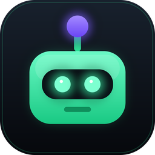
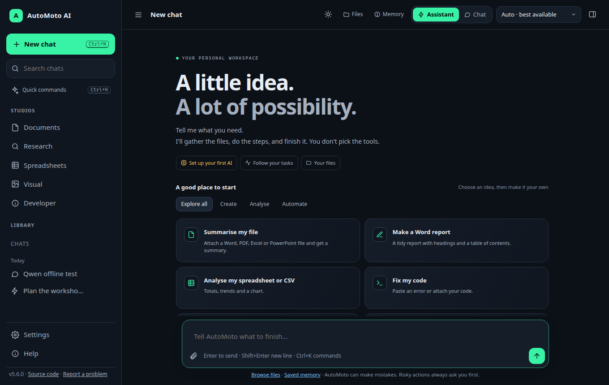
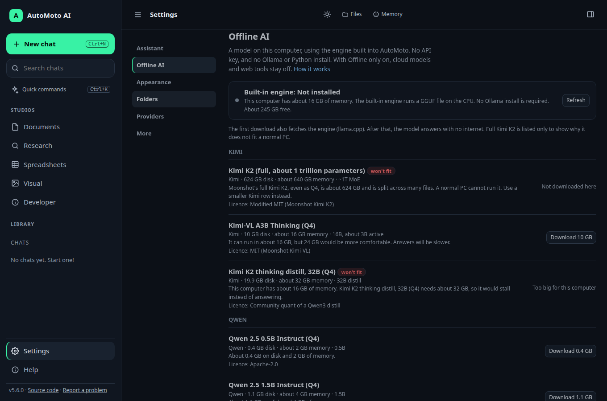
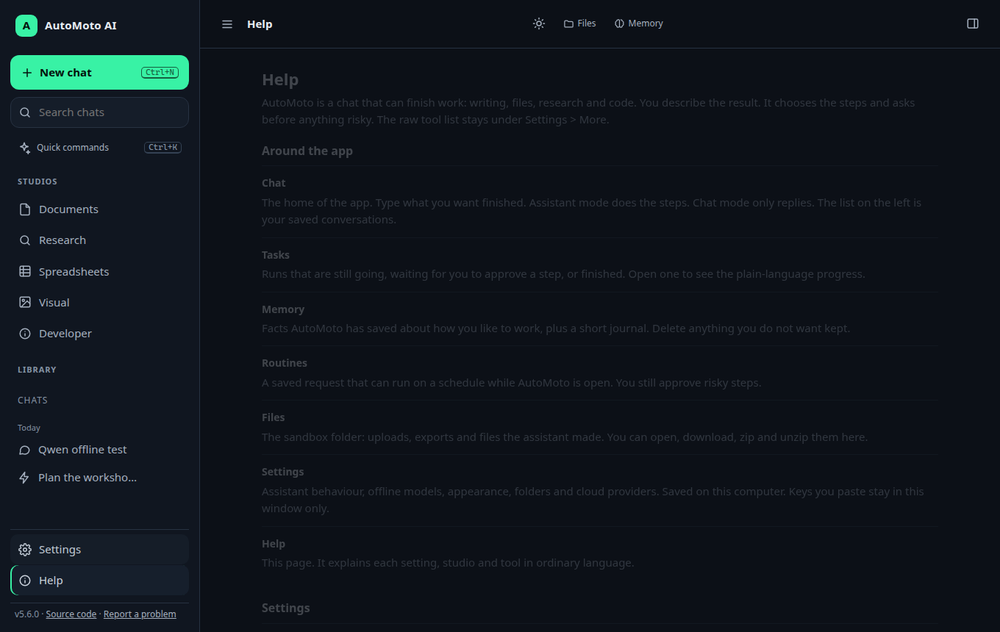
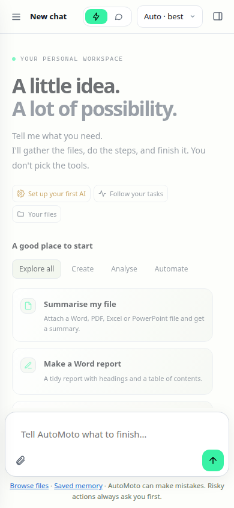

<div align="center">



# AutoMoto AI

**The AI agent that does the work, and asks before anything risky**

Give it a goal. It chooses the steps, works on your files in a sandbox, and
asks before anything risky. After you download a model, it can run fully offline
on this computer — no extra installs.

<p>
  <a href="https://github.com/ymmiah/AutoMotoAI/releases/latest"></a>
  <a href="https://github.com/ymmiah/AutoMotoAI/actions/workflows/ci.yml"></a>
  <a href="#licence"></a>
  <a href="https://apps.microsoft.com/detail/9N9J7FLSSFG8"></a>
  <a href="#platforms-and-roadmap"></a>
  <a href="https://github.com/ymmiah/AutoMotoAI/releases"></a>
</p>

<a href="https://apps.microsoft.com/detail/9N9J7FLSSFG8" title="Get it from Microsoft">
  <picture>
    <source media="(prefers-color-scheme: dark)" srcset="https://get.microsoft.com/images/en-us%20light.svg">
    
  </picture>
</a>

<p>
  <sub>
    <strong>Advanced:</strong>
    <a href="https://github.com/ymmiah/AutoMotoAI/releases/download/v5.6.0/AutoMoto-AI-Setup-5.6.0-Windows-x64.exe">direct installer (.exe)</a>
    ·
    <a href="https://github.com/ymmiah/AutoMotoAI/releases/download/v5.6.0/AutoMoto-AI-5.6.0-Windows-x64.msi">direct installer (.msi)</a>
    — may show a SmartScreen warning until signed.
    See the <a href="https://github.com/ymmiah/AutoMotoAI/releases/tag/v5.6.0">v5.6.0 release</a>.
  </sub>
</p>

</div>

## Contents

- [Why AutoMoto](#why-automoto)
- [Key features](#key-features)
- [Screenshots](#screenshots)
- [Install](#install)
- [Quick start](#quick-start)
- [Offline AI](#offline-ai)
- [Platforms and roadmap](#platforms-and-roadmap)
- [Docs](#docs)
- [Contributing](#contributing)
- [Licence](#licence)
- [Credits](#credits)

## Why AutoMoto

Most assistants only talk. AutoMoto is built to **finish the work**: research a topic,
write a report, analyse a spreadsheet, edit a document, or work through a coding task.

You describe the result. It picks the tools, shows its steps in plain language, and
**asks before anything risky** — a command, a file change, or leaving the sandbox.
Your keys and files stay under your control. Chat, settings and models all have
in-app help (press <kbd>F1</kbd>).

New here? **[Start here: pick your device](docs/START.md)**
([docs site](https://ymmiah.github.io/AutoMotoAI/START.html)).

## Key features

- **One smart assistant.** Say what you need or attach a file. AutoMoto works out
  the steps, picks the tools, and shows progress in plain words.
- **Offline AI, no extra installs.** [Settings → Offline AI](docs/OFFLINE.md)
  downloads a GGUF model and a built-in llama.cpp engine. No Ollama, no Python,
  no separate runtime. After the download, chat works with the network off.
  The catalogue includes smaller **Kimi**, **Qwen**, **Llama**, **Mistral**,
  **Gemma**, **DeepSeek** and **Phi** models, and you can import any `.gguf` file.
  Full Kimi K2 (about 624 GB) is listed so the size is visible, and is not offered
  as a download. A model that will not fit this computer says why.
- **Studios** for the work you actually do, with in-app help for each one:
  [Document Assistant](docs/DOCUMENT-ASSISTANT-V7.md),
  [Spreadsheet & Invoice](docs/INVOICE-SPREADSHEET-V8.md),
  [Research Studio](docs/RESEARCH-STUDIO-V8.md),
  [Visual Studio](docs/VISUAL-STUDIO.md),
  and [Developer Studio](docs/DEVELOPER-STUDIO-V9.md) through
  [V31](docs/DEVELOPER-STUDIO-V31.md). An overview is in
  [Studios the assistant can use](docs/STUDIO-ASSISTANT.md).
- **Privacy, local-first.** No telemetry, no analytics, no ads. The app only talks
  to the providers, pages, connectors and account server you choose. Risky steps
  wait for your approval. Full list: **[Privacy policy](docs/PRIVACY.md)**.

## Screenshots

| Chat-first layout | Settings → Offline AI |
|:---:|:---:|
|  |  |
| **In-app Help** | **Phone layout** |
|  |  |

## Install

**Windows 10/11 (recommended):** [Get it from Microsoft](https://apps.microsoft.com/detail/9N9J7FLSSFG8)
(Store ID `9N9J7FLSSFG8`). Microsoft signs this copy, so Windows does not show an
unknown-publisher warning, and the Store updates the app for you.

**Advanced — direct installers** from the [v5.6.0 GitHub release](https://github.com/ymmiah/AutoMotoAI/releases/tag/v5.6.0).
These may show a SmartScreen warning until they are Authenticode-signed.

| You have | Get | Notes |
|---|---|---|
| **Windows 10/11** | **[Get it from Microsoft](https://apps.microsoft.com/detail/9N9J7FLSSFG8)** | Recommended |
| **Advanced — exe** | [`AutoMoto-AI-Setup-5.6.0-Windows-x64.exe`](https://github.com/ymmiah/AutoMotoAI/releases/download/v5.6.0/AutoMoto-AI-Setup-5.6.0-Windows-x64.exe) | Per-user, no admin |
| **Advanced — msi** | [`AutoMoto-AI-5.6.0-Windows-x64.msi`](https://github.com/ymmiah/AutoMotoAI/releases/download/v5.6.0/AutoMoto-AI-5.6.0-Windows-x64.msi) | IT / all users, `msiexec /i <file> /qn` |
| **VS Code** | [`AutoMoto-AI-5.6.0-VSCode.vsix`](https://github.com/ymmiah/AutoMotoAI/releases/download/v5.6.0/AutoMoto-AI-5.6.0-VSCode.vsix) | Extensions → ⋯ → Install from VSIX |
| **Python 3.10+** (any OS) | [`automoto_ai-5.6.0-py3-none-any.whl`](https://github.com/ymmiah/AutoMotoAI/releases/download/v5.6.0/automoto_ai-5.6.0-py3-none-any.whl) | Command-line engine and web UI |
| **Mac, Linux, phone or tablet** | [Start here: pick your device](docs/START.md) | Phones sign in from the browser; no store app yet |

Step-by-step for every OS, Docker, hosting and troubleshooting:
**[Install guide](docs/INSTALL.md)** · **[GUI guide](docs/GUI-GUIDE.md)**.

<details>
<summary>Command-line engine (Windows, macOS, Linux)</summary>

The Windows app does not need this if you only sign in to an account. Use it for
Local mode's engine, the terminal, or the web UI at `http://127.0.0.1:8765`.

**Windows (PowerShell):**

```powershell
winget install -e --id Python.Python.3.12
git clone https://github.com/ymmiah/AutoMotoAI
cd AutoMotoAI
powershell -ExecutionPolicy Bypass -File scripts\install.ps1
```

**macOS / Linux:**

```bash
# macOS: brew install python@3.12 git
# Debian/Ubuntu: sudo apt install python3 python3-venv git
git clone https://github.com/ymmiah/AutoMotoAI
cd AutoMotoAI
./scripts/install.sh
```

Then add a provider key to `~/.automoto/.env` and run `automoto serve`.
Pin a release with `-Version 5.6.0` / `--version 5.6.0`.
Docker and hosted mode: [Install](docs/INSTALL.md) · [Hosting](docs/HOSTING.md).

</details>

## Quick start

1. Install from the [Microsoft Store](https://apps.microsoft.com/detail/9N9J7FLSSFG8).
2. Open **AutoMoto AI**. Sign in to your account, or choose **Start local mode**.
3. For offline chat, open **Settings → Offline AI**, download a model that fits this
   computer, then click **Use** and **Test**.
4. Press <kbd>F1</kbd> or open **Help** for plain-language guides to every setting,
   studio and tool.
5. Describe what you want finished, or pick one of the idea cards on the home screen.

The window is chat-first: studios and chats in the sidebar, the conversation in the
main column, Settings in its own panel. The Windows caption bar is AutoMoto's own.

## Offline AI

Open **Settings → Offline AI** at any time. AutoMoto downloads a model and a pinned
llama.cpp engine into its own folder. You do not install Ollama, Python or llama.cpp
yourself. The first download needs the internet; after that, chat works with the
network off. Prompts and files for that chat stay on the PC.

Pick a row that fits, or the one marked **Best fit**. Rows marked **Won't fit**
explain why. You can delete a model, or **Import** a `.gguf` file you already have.

Full Kimi K2 is about a trillion parameters — even the Q4 copy is about 624 GB —
so it is listed without a download button. Smaller Kimi, Qwen, Llama, Mistral,
Gemma, DeepSeek and Phi options show disk and memory needs.

Details, sizes and troubleshooting: **[Offline AI](docs/OFFLINE.md)**.

## Platforms and roadmap

| Platform | Status |
|---|---|
| **Windows 10/11** (64-bit) | Current stable app, version **5.6.0**. Recommended from the Microsoft Store; GitHub `.exe` / `.msi` also published. |
| **VS Code** | Extension on the [v5.6.0 release](https://github.com/ymmiah/AutoMotoAI/releases/tag/v5.6.0). |
| **Python engine** | Command line and web UI on Windows, macOS and Linux (Python 3.10+). |
| **Android / iOS** | The layout fits phone screens. CI builds an Android APK/AAB and an iOS simulator build when a Mac runner is free. They are not on the Play Store or App Store yet. Phones can sign in to an account server from the browser. See [iPhone apps](docs/IOS.md). |
| **macOS / Linux desktop app** | The same codebase can be built; those installers are not released or tested in CI yet. Use the Python engine and [Start here](docs/START.md) for now. |

## Docs

| Guide | |
|---|---|
| **[Start here](docs/START.md)** | Short steps for a Windows PC, phone, Mac, Linux or VS Code |
| **[GUI guide](docs/GUI-GUIDE.md)** | The app, page by page, with screenshots |
| **[Install](docs/INSTALL.md)** | Every OS, Docker, updates, uninstall, troubleshooting |
| **[Offline AI](docs/OFFLINE.md)** | Built-in models, sizes, import, and what "won't fit" means |
| **[What you can ask for](docs/CAPABILITIES.md)** | Tasks and tools the assistant can take on |
| **[Studios](docs/STUDIO-ASSISTANT.md)** | Document, spreadsheet, research, visual and developer studios |
| **[Privacy](docs/PRIVACY.md)** | What the app connects to, and when |
| **[Hosting](docs/HOSTING.md)** · **[Your own server](docs/SERVER-SETUP.md)** | Accounts, daily limits, first-admin setup |
| **[Windows distribution](docs/WINDOWS-DISTRIBUTION.md)** · **[Signing setup](docs/signing/TRUSTED_SIGNING_SETUP.md)** | Store, SmartScreen, Azure Artifact Signing (maintainers) |
| **[Publishing](docs/PUBLISHING.md)** · **[Changelog](CHANGELOG.md)** · **[Security](SECURITY.md)** | Releases, history, and the security model |

The docs site, with a copy button on every command: [ymmiah.github.io/AutoMotoAI](https://ymmiah.github.io/AutoMotoAI/).

## Contributing

Bugs and ideas: [GitHub Issues](https://github.com/ymmiah/AutoMotoAI/issues).
How to set up a dev environment, run tests, and the sign-off we need:
**[CONTRIBUTING.md](CONTRIBUTING.md)**.

## Licence

Copyright (C) 2025-2026 Yasin Mohammed Miah. AutoMoto AI is dual-licensed:

- **Free under [AGPL-3.0-only](LICENSE)** (see [NOTICE](NOTICE)) for personal,
  educational and open-source use. If you change it and run it as a service for
  others, you must offer them your source. The in-app **Source code** link does
  this (`AUTOMOTO_SOURCE_URL` for a modified copy).
- **[Commercial licence](COMMERCIAL-LICENSE.md)** if you want to use, embed,
  modify or host it in a closed-source or commercial product without the AGPL
  obligations. Contact via [ymmiah.com](https://ymmiah.com) or
  [GitHub](https://github.com/ymmiah).

Versions up to and including **5.6.0-beta.3** were released under MIT and stay
MIT for those copies. Contributions need a sign-off that allows commercial
licensing ([CONTRIBUTING.md](CONTRIBUTING.md#licence-of-contributions)).

## Credits

Built by **Yasin Mohammed Miah, Student of BCU, BSc Computing Top-Up (Hons)**.

[GitHub](https://github.com/ymmiah) · [LinkedIn](https://linkedin.com/in/ymmiah) · [ymmiah.com](https://ymmiah.com)
