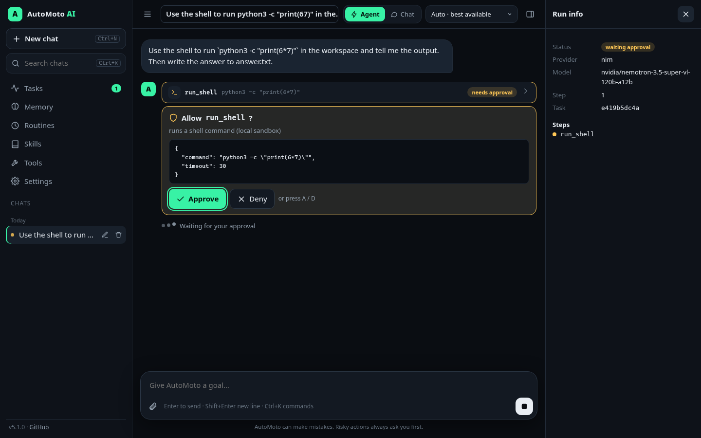
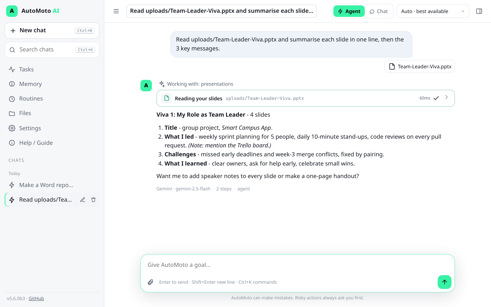
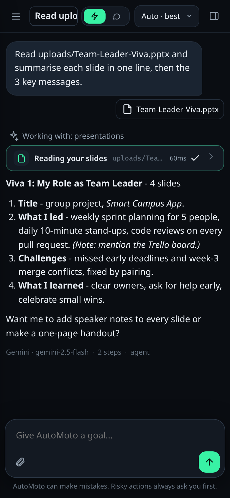
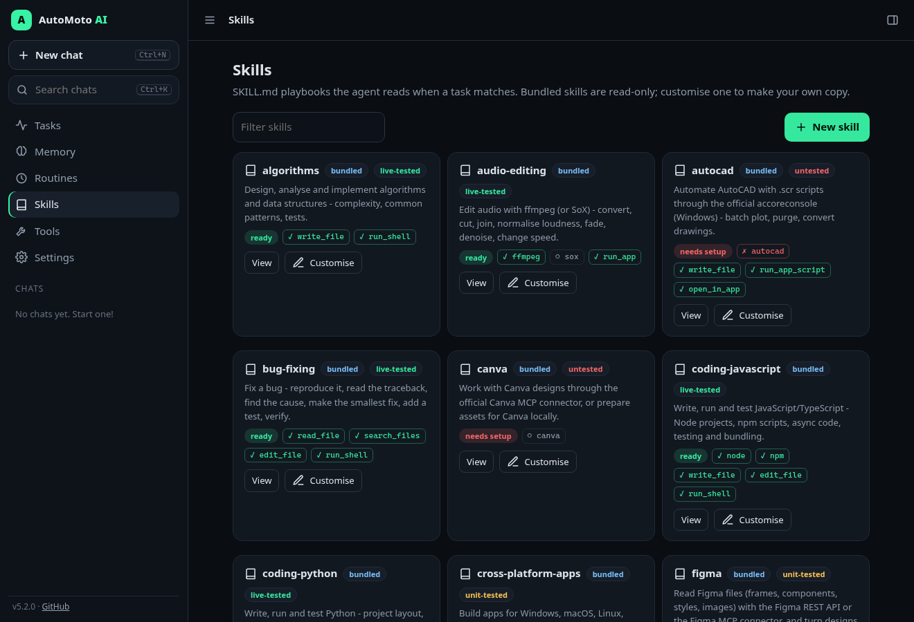
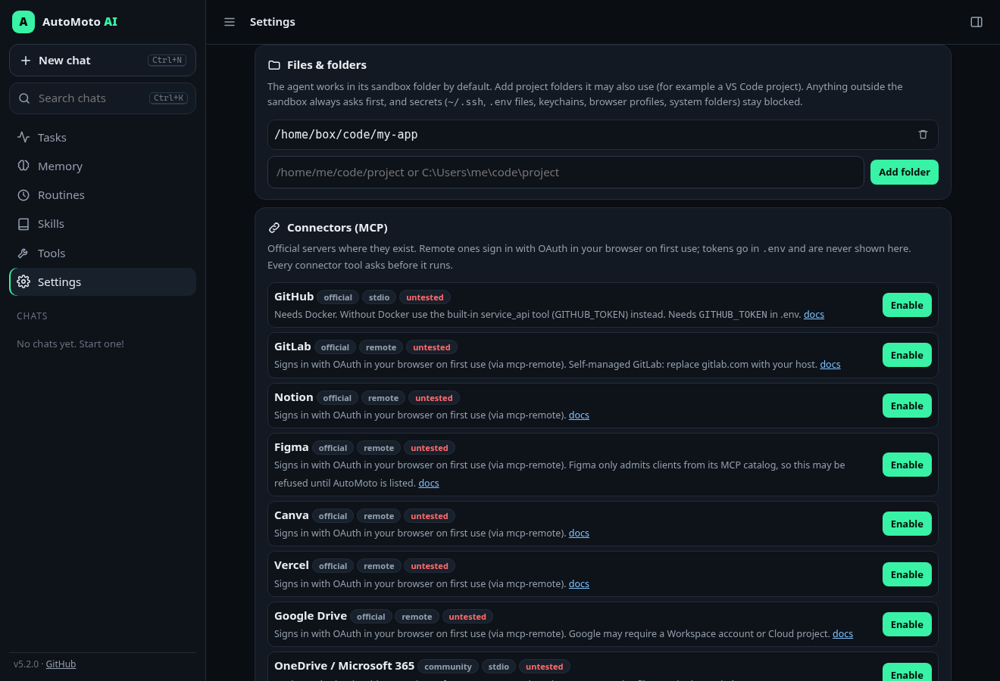

<div align="center">

# 🤖 AutoMoto AI

### Your AI cousin — an agent that actually *does* the work.

Give it a goal. It picks the best free AI, searches the web, reads and writes files in its own
sandbox, runs commands **after you approve**, remembers what matters, and keeps going until the
job is done. If one AI is rate-limited or down, the next one carries on mid-task.

[](CHANGELOG.md)
[](https://github.com/ymmiah/AutoMotoAI/actions)
[](LICENSE)




</div>

---

## ✨ What it can do

- **🖥 Feel like a real app.** A full chat app at `python -m automoto serve` (and inside the desktop shell): saved conversations, live tool-step cards, inline approvals, image attach, Memory / Routines / Skills / Tasks / Tools / Settings pages, dark and light themes, a command palette and a layout that works on a phone. [See the GUI](#-the-app).

- **🧑‍💻 Work inside VS Code.** The [AutoMoto extension](#-vs-code-extension) adds a chat view and commands: ask about a selection, fix a diagnostic, explain a file, or run a task on your project. Every risky step shows up as an Allow / Deny dialog.
- **📚 Use 33 bundled skills.** Web design, graphic design, video and audio editing, bug fixing, the Linux terminal, Python, JavaScript, HTML/CSS, LaTeX, Go, algorithms and cross-platform apps, plus one skill per app or service. Each skill shows whether this computer has what it needs and how far it has been tested ([table](#-skills-library)).
- **🧩 Drive local apps through their official routes.** ffmpeg, ImageMagick, Inkscape, LibreOffice, Tectonic/LaTeX, git, Node, Python and Go from the command line; Photoshop and Illustrator through ExtendScript; AutoCAD through `accoreconsole`; and open-only support for Premiere, Figma and Canva. Licensing is never bypassed.
- **🔌 Reach your services.** Built-in REST calls for GitHub, GitLab, Vercel, Figma, Notion and Zotero, and a one-click catalogue of official MCP connectors (GitHub, GitLab, Notion, Figma, Canva, Vercel, Google Drive, OneDrive, Zotero). Amazon, eBay, Etsy and Booking.com are research-only: **AutoMoto never buys or books.**
- **📂 Work in your own folders when you allow it.** Add project folders in Settings → Files. Anything outside the sandbox asks first, and secrets (`~/.ssh`, `.env` files, keychains, browser profiles, system folders) stay blocked.
- **🛠 Work like an agent, not a chat box.** It plans, calls tools, reads the results and repeats until the goal is met (with a step limit so it can't loop forever).
- **🔀 Use every AI you have a key for.** NVIDIA NIM, Gemini, Groq, OpenRouter (free tiers) plus OpenAI and Claude. It picks the best one for each step and **fails over mid-task** on rate limits, 5xx errors, bad keys or timeouts.
- **👁 Know which AIs can see.** Screenshots and photos only go to vision-capable models.
- **🔎 Research with sources.** Free web search (DuckDuckGo, no key) and page fetching behind an SSRF guard.
- **📁 Have its own little computer.** Files and shell commands are jailed to a sandbox workspace, with an optional throwaway Docker container.
- **✋ Ask before anything risky.** Shell commands, writes outside `scratch/`, desktop actions and deleting memories wait for **Approve / Deny** in the web UI or **y/n** in the terminal. Destructive commands are blocked outright.
- **🧠 Remember you.** SQLite memory of facts about you and your projects plus a dated journal, fed into every run.
- **📚 Follow skills.** Drop a `SKILL.md` into `~/.automoto/skills/` and it will load and follow it when a task matches.
- **⏰ Run routines.** "Every weekday at 8:00, check the news on X and summarise it", on an interval or cron schedule, while the server is up.
- **🧵 Run in the background.** Every agent run is a background task, so the chat stays responsive and you can stop a task from the panel.
- **🛡 Resist hijacking.** The server listens on 127.0.0.1 only, and you sign in with a one-time link that sets an HttpOnly cookie. It checks Host and Origin (against DNS rebinding and CSRF) and rate-limits requests. Web and file content is fenced as untrusted, and once the agent reads web content, even auto mode asks again before risky steps. Details are in [SECURITY.md](SECURITY.md#threat-model).

---

## 🧭 How it works


Every step goes back through the router, so if NIM rate-limits you on step 4, Groq or Gemini
picks up the same history on step 5. The agent keeps one provider-neutral history and renders
it per provider (OpenAI tool messages, Claude `tool_use` blocks, or plain text for models
without native tool calling).

---

## 🖥 The app

`python -m automoto serve` opens a full app in your browser (the Tauri desktop shell shows the same one).
Everything ships inside the Python package, with no build step and no CDN: the libraries are vendored and the page runs under a strict Content-Security-Policy (`script-src 'self'`, no inline scripts).

<div align="center">

&nbsp;

</div>

- **💬 Chats that stick around.** Every conversation is saved in SQLite (`~/.automoto/conversations.db`) and listed in the sidebar by Today / Yesterday / Previous 7 days / Older. You can search titles and message text, rename and delete. Titles come from your first message.
- **⚡ Agent or 💭 Chat.** Use the toggle to switch: **Agent** uses tools step by step, **Chat** gives a plain answer. The provider picker defaults to **Auto** and the footer of every answer shows which AI answered, the model, the step count and any failovers.
- **🧩 Live steps.** Each tool call is a collapsible card with an icon, its arguments, the result and its timing. Risky calls show an inline **Approve / Deny** card (keys **A** / **D**). **Stop** cancels between steps or while a run waits for approval. Runs keep going in the background if you switch chats, and the sidebar marks running chats.
- **🖼 Images.** Paste, drag and drop, or use the 📎 button (up to 4 per message). Big photos are shrunk in the browser first, and images only go to vision-capable models.
- **📝 Nice answers.** Markdown rendering (sanitised with DOMPurify), syntax-highlighted code blocks with copy buttons, and a copy button on every answer.
- **📄 Pages.**
  - **Memory:** add, filter and forget facts, plus a journal timeline.
  - **Routines:** create, edit, pause or resume, run now, delete, and see the last result.
  - **Skills:** browse, view, create and edit `SKILL.md` files. Bundled skills are read-only; **Customise** makes your own copy.
  - **Tasks:** every run, live, with a stop button.
  - **Tools:** every tool with a safe / risky / blocked badge.
  - **Settings:** theme (dark, light or system), accent colour, approval mode, default mode, provider order, and bring-your-own keys.
- **🔑 Keys stay in the tab.** BYOK keys live in `sessionStorage` only. They are sent with each request, never saved on the server (the settings API rejects anything that looks like a key), and they are wiped when you close the tab.
- **⌨ Keyboard.**
  - <kbd>Ctrl/⌘ K</kbd>: command palette (commands and chats)
  - <kbd>Ctrl/⌘ N</kbd>: new chat. Chrome keeps Ctrl+N for itself, so use <kbd>Ctrl/⌘ Shift O</kbd> there.
  - <kbd>Ctrl/⌘ B</kbd>: toggle the sidebar
  - <kbd>Enter</kbd> sends, <kbd>Shift Enter</kbd> adds a new line
  - <kbd>Esc</kbd> stops a run or closes a dialog
- **♿ Accessible and responsive.** Built with landmarks, ARIA labels, a live region for the chat, visible focus rings and a skip link, and it honours `prefers-reduced-motion`. Below 760 px wide the sidebar slides in from the side.

---

## 🧑‍💻 VS Code extension

`apps/vscode` is a TypeScript extension that talks to your running `python -m automoto serve`. It finds the
server through AutoMoto's private session file (`~/.automoto/session.json`, mode 0600) and only connects to
`127.0.0.1` / `localhost`.

```bash
python -m automoto serve --no-browser                   # 1. start AutoMoto
cd apps/vscode && npm ci && npm run package             # 2. build automoto-ai-5.2.0.vsix (or download it from CI)
code --install-extension automoto-ai-5.2.0.vsix         # 3. install it (or Extensions → … → Install from VSIX)
```

| Command | What it does |
|---|---|
| **AutoMoto: Ask about selection** (<kbd>Ctrl/⌘ Alt A</kbd>) | Sends the selected code with your question. |
| **AutoMoto: Fix this error** (also a 💡 quick fix) | The agent reads the file, makes the smallest fix with `edit_file`, runs the tests and explains the change. |
| **AutoMoto: Explain this file** | Available from the editor and Explorer context menus. |
| **AutoMoto: Run agent task on workspace…** | Any goal. The agent works in the open folder. |
| **AutoMoto: Let the agent work in this folder** · **Open the web UI** · **Show connection status** | |

Before the agent touches your project, VS Code asks if you want to add the folder to AutoMoto's allowed folders.
This only works in a trusted workspace. Each write, edit, command or app run then shows a modal **Allow / Deny**
dialog with the reason and the arguments. The chat view renders text only (no HTML from the model), uses a strict
CSP with a nonce, and keeps the token in the extension host, never in the webview.

**Tested:** lint, compile and 7 unit tests (session discovery, loopback-only URLs, prompt fencing, a full agent run
with approvals against a fake server). An integration test runs in a real VS Code under xvfb (activation, commands,
the clear "not running" error). The extension's client also ran live against `automoto serve` with NVIDIA NIM, for
the video-editing and bug-fixing runs in the skills table below. CI builds the `.vsix` and uploads it as an artifact.

---

## 📚 Skills library

Skills are `SKILL.md` playbooks: the agent sees their names and descriptions and loads one with `load_skill`
when a task matches. Each one declares the tools, apps, keys or connectors it needs. `python -m automoto skills`
and the **Skills** page show whether this computer has them (✓ / ✗ / ○ optional).

Status: ✅ **live-tested** means the apps and tools the skill uses were run for real for this release. 🟡
**unit-tested** means it is covered by automated tests but wasn't run against the real app or service. 🔴
**untested** means it was written from the official docs, but the app or sign-in wasn't available to test.

<div align="center"></div>

| Skill | Category | Needs | Status | Notes |
|---|---|---|---|---|
| `algorithms` | coding | built-in tools | ✅ live-tested | file/shell tools only (run for real in these tests) |
| `audio-editing` | media | `ffmpeg`, `sox` (optional) | ✅ live-tested | ffmpeg loudnorm + fade run for real; SoX optional, not installed on the test box |
| `autocad` | cad | `autocad` | 🔴 untested | accoreconsole is Windows-only and licensed: not available to test |
| `bug-fixing` | coding | built-in tools | ✅ live-tested | NIM agent fixed a planted bug in an allowed folder via the VS Code client and ignored an injected comment |
| `canva` | design | canva connector | 🔴 untested | official MCP connector, OAuth sign-in needed: can't be done unattended |
| `coding-javascript` | coding | `node`, `npm` | ✅ live-tested | node + npm run for real |
| `coding-python` | coding | `python` | ✅ live-tested | python run via run_app/run_shell |
| `cross-platform-apps` | coding | `node or cargo or flutter or python or go` (optional) | 🟡 unit-tested | Go/Node/Python builds run for real; Tauri needs a newer Rust than the test box, Flutter/Xcode not installed |
| `figma` | design | `FIGMA_TOKEN`, figma connector | 🟡 unit-tested | REST calls unit-tested; Figma's MCP only admits listed clients |
| `github` | services | `git` (optional), `gh` (optional), `GITHUB_TOKEN or GH_TOKEN` | ✅ live-tested | public API reads live (repo + commits); writes need GITHUB_TOKEN and stay unit-tested |
| `gitlab` | services | `glab` (optional), `GITLAB_TOKEN` | ✅ live-tested | public project read live; token calls unit-tested |
| `go` | coding | `go` | ✅ live-tested | `go run` for real |
| `google-drive` | services | google-drive connector | 🔴 untested | official MCP connector, OAuth sign-in needed |
| `graphic-design` | design | `imagemagick or inkscape` | ✅ live-tested | ImageMagick SVG→PNG, resize and text run for real; Inkscape path unit-tested |
| `html-css` | coding | built-in tools | ✅ live-tested | file/shell tools only (run for real in these tests) |
| `illustrator` | design | `illustrator` | 🔴 untested | needs licensed Illustrator on Windows/macOS: not available to test |
| `latex` | documents | `tectonic or pdflatex or latexmk` | ✅ live-tested | Tectonic built a PDF with maths; pdflatex/latexmk use the same flow |
| `linux-terminal` | system | built-in tools | ✅ live-tested | file/shell tools only (run for real in these tests) |
| `notion` | services | `NOTION_TOKEN`, notion connector | 🟡 unit-tested | REST calls unit-tested with a fake server; MCP needs OAuth |
| `onedrive` | services | onedrive connector | 🔴 untested | community MCP server, Microsoft sign-in needed |
| `online-shopping` | research | built-in tools | 🟡 unit-tested | web search/fetch are live; store pages often block automated reads. Never buys |
| `photoshop` | design | `photoshop` | 🔴 untested | needs licensed Photoshop on Windows/macOS: not available to test |
| `premiere-pro` | media | `premiere`, `ffmpeg` (optional) | 🔴 untested | opens projects only; Premiere scripting needs a panel inside the app |
| `project-scaffold` | coding | built-in tools | ✅ live-tested | file/shell tools only (run for real in these tests) |
| `repo-health-check` | coding | built-in tools | ✅ live-tested | file/shell tools only (run for real in these tests) |
| `research-brief` | research | built-in tools | ✅ live-tested | file/shell tools only (run for real in these tests) |
| `travel-booking` | research | built-in tools | 🟡 unit-tested | web search/fetch are live; Booking.com prices are often hidden from bots. Never books |
| `vercel` | services | `vercel` (optional), `VERCEL_TOKEN` | 🟡 unit-tested | REST calls unit-tested; needs VERCEL_TOKEN |
| `video-editing` | media | `ffmpeg`, `ffprobe` | ✅ live-tested | NIM agent ran it end to end: ffmpeg made a clip, ffprobe checked it (4.000 s, 320×240) |
| `vscode` | coding | `vscode` (optional) | 🟡 unit-tested | extension tested in a real VS Code under xvfb; `code` CLI not on the test box |
| `web-design` | design | `python or node` (optional) | ✅ live-tested | file/shell tools only (run for real in these tests) |
| `write-a-skill` | general | built-in tools | 🟡 unit-tested | file/shell tools only (run for real in these tests) |
| `zotero` | research | `ZOTERO_API_KEY` | 🟡 unit-tested | REST calls unit-tested; needs ZOTERO_API_KEY |

Add your own in `~/.automoto/skills/<name>/SKILL.md`, or use **Customise** on a bundled one.

---

## 🧩 Local apps

`python -m automoto apps` lists what AutoMoto can drive and whether it's installed. The agent uses `list_apps`
(safe), then `run_app`, `open_in_app` and `run_app_script`. All three are **risky**, so they always ask.

- **Command-line apps** run without a shell (an argument list, not a string), in the working folder, with
  secret-free environment variables and a timeout. Each app has a deny-list for its dangerous flags. ffmpeg gets
  no network inputs, `concat`/`-safe` or `pipe:`. ImageMagick gets no `@file` or `msl:`. git gets no `-c`,
  `--upload-pack`, `config` or `credential`. VS Code can't install extensions. `gh`, `npm`, `vercel` and `cargo`
  can't log in or publish. Docker gets no `--privileged` or volume mounts. LaTeX gets no shell-escape. Every
  path-like argument must be inside an allowed folder and not a secret.
- **Licensed GUI apps** use only their official automation:

| App | Route | Windows | macOS | Linux | Status |
|---|---|---|---|---|---|
| Photoshop, Illustrator | ExtendScript `.jsx` | COM `DoJavaScriptFile` | AppleScript `do javascript` | not sold for Linux | 🔴 untested (no licence on the test box) |
| AutoCAD | `.scr` via `accoreconsole.exe` | ✅ route | open only | not sold for Linux | 🔴 untested |
| Premiere Pro | open project/media | ✅ | ✅ | n/a | 🔴 untested; scripting needs a panel inside Premiere |
| Blender, GIMP | `blender -b --python`, Script-Fu batch | ✅ | ✅ | ✅ | 🔴 untested |
| Figma, Canva desktop | open only (use the connectors for data) | ✅ | ✅ | n/a | 🔴 untested |
| ffmpeg, ffprobe, ImageMagick, LibreOffice, Tectonic, git, Node, npm, Python, Go | CLI | ✅ | ✅ | ✅ | ✅ live-tested on Linux |
| Inkscape, SoX, pandoc, pdflatex, latexmk, VS Code CLI, gh, glab, vercel, cargo, Docker | CLI | ✅ | ✅ | ✅ | 🟡 unit-tested (not installed on the test box) |

---

## 🔌 Services & connectors

**Built-in `service_api` tool.** It calls a service's official REST API on a fixed host with your token. The
token comes from `.env` or from this tab's BYOK keys, is redacted from output, and is never forwarded on a
redirect to another host.

| Service | Token | Live |
|---|---|---|
| GitHub | `GITHUB_TOKEN` (fine-grained PAT; public reads need none) | ✅ public reads (`/repos/ymmiah/AutoMotoAI`, commits) |
| GitLab | `GITLAB_TOKEN`, optional `GITLAB_URL` | ✅ public project read |
| Vercel · Figma · Notion · Zotero | `VERCEL_TOKEN` · `FIGMA_TOKEN` · `NOTION_TOKEN` · `ZOTERO_API_KEY` + `ZOTERO_USER_ID` | 🟡 unit-tested |

GETs are safe; POST/PUT/PATCH/DELETE always ask. Some calls are **blocked**: keys, secrets, tokens, webhooks,
members, permissions, CI variables and env vars, and deleting a whole repo, project, group or account.

<div align="center"></div>

**MCP connector catalogue** (Settings → Connectors, or `python -m automoto mcp [enable|disable] ID`). It writes
`mcp.json` with `${VAR}` placeholders, never the secret values. MCP servers start with a cleaned environment, so
they don't see your AI keys. Every connector tool asks before it runs.

| Connector | Server | Sign-in | Status |
|---|---|---|---|
| GitHub | `ghcr.io/github/github-mcp-server` (official, Docker) | `GITHUB_TOKEN` | 🔴 untested (no Docker on the test box) |
| GitLab · Notion · Figma · Canva · Vercel · Google Drive | the vendor's official remote MCP via `npx mcp-remote` | OAuth in your browser | 🔴 untested (interactive OAuth) |
| OneDrive / Microsoft 365 | `@softeria/ms-365-mcp-server` (community) | Microsoft device code | 🔴 untested |
| Zotero | `zotero-mcp` (community, local Zotero API) | none | 🔴 untested |
| Folder (reference filesystem server) | `@modelcontextprotocol/server-filesystem` | none | ✅ live: connected, 14 tools, read a file |

**Shopping and travel** (Amazon, eBay, Etsy, Booking.com). Their APIs are for approved partners only, so the
`online-shopping` and `travel-booking` skills research public pages with `web_search` / `fetch_url`, then
hand you links. AutoMoto never adds to a basket, bids, books, pays or enters card details.

---

## 🚀 Quick start

```bash
pip install -r requirements.txt
cp .env.example .env            # add at least one key, e.g. NVIDIA_API_KEY (free: build.nvidia.com)
python -m automoto serve        # prints a one-time sign-in link and opens it
```

The server prints `Open (one-time link): http://127.0.0.1:8765/?launch=…`. That link signs your browser in with
an HttpOnly cookie and stops working once used. Lost the tab? Run `python -m automoto open`.

On Windows use `copy .env.example .env`. You can also run `./setup.sh` / `setup.bat` and then `./run.sh` / `run.bat`.

More ways to use it:

```bash
python -m automoto                         # agent chat in the terminal (approvals as y/n)
python -m automoto do "Find the 3 newest NVIDIA NIM models and save a summary to scratch/nim.md"
python -m automoto do "What does this error mean?" --image screenshot.png
python -m automoto --plain                 # plain chat, no tools (v4 behaviour)
python -m automoto status                  # which AIs are ready + vision matrix
python -m automoto tools                   # every tool and its safety level
python -m automoto skills                  # skills + whether this computer has what they need
python -m automoto apps                    # local apps AutoMoto can drive
python -m automoto mcp enable notion       # add an official connector (then restart serve)
python -m automoto open                    # open the running web UI with a fresh one-time sign-in link
python -m automoto --workspace ~/code/app do "fix the failing test"   # folder must be in allowed folders
python -m automoto memory add "I prefer concise answers"
python -m automoto routines add news --cron "0 8 * * 1-5" --prompt "Search the web for AI news and give me 5 bullets with links"
```

---

## 👁 Providers, vision & tool calling

Every model can be overridden in `.env` (`NIM_MODEL`, `NIM_AGENT_MODEL`, `GROQ_VISION_MODEL`, and so on).

| Provider | Key | Free tier | Vision | Agent tool calling | Agent model (first try) | Vision model |
|---|---|---|---|---|---|---|
| **NVIDIA NIM** | `NVIDIA_API_KEY` | ✅ | ✅ | native ✅ *(live-tested)* | `nvidia/nemotron-3.5-super-vl-120b-a12b` | `meta/llama-3.2-11b-vision-instruct` |
| **Google Gemini** | `GEMINI_API_KEY` | ✅ | ✅ | native (OpenAI-compatible endpoint) | `gemini-flash-latest` | `gemini-flash-latest` |
| **Groq** | `GROQ_API_KEY` | ✅ | ✅ (preview) | native | `openai/gpt-oss-120b` | `qwen/qwen3.8-27b` |
| **OpenRouter** | `OPENROUTER_API_KEY` | ✅ `:free` | ✅ | JSON-in-text fallback | `openrouter/free` | `google/gemma-4-31b-it:free` |
| **OpenAI** | `OPENAI_API_KEY` | paid | ✅ | native | `gpt-5.4-mini` | `gpt-5.4-mini` |
| **Anthropic Claude** | `ANTHROPIC_API_KEY` | paid | ✅ | native (`tool_use`) | `claude-haiku-4-5` | `claude-haiku-4-5` |

- If a native tool call is rejected (400/404/422), the same model is retried with the text protocol before AutoMoto moves to the next provider. Set `AUTOMOTO_TOOL_MODE=text` to force the text protocol.
- A provider whose key is rejected (401/403) is skipped for the rest of that run.
- How it picks: images go to the strongest vision model, code and deep reasoning go to the strongest model, and quick chat goes to the fastest. Your `--prefer` / `AI_PROVIDER` choice always goes first.

---

## 🧰 Tools

| Tool | Safety | What it does |
|---|---|---|
| `list_dir`, `read_file`, `search_files` | 🟢 safe in the workspace · 🟠 risky in other allowed folders | Read, list, regex-search (secrets and `.git`/`node_modules` skipped) |
| `write_file` | 🟢 safe in `scratch/` · 🟠 risky elsewhere | Create, overwrite or append a text file |
| `edit_file` | 🟠 risky | Replace an exact, unique snippet (safer than rewriting a file) |
| `list_apps` · `run_app`, `open_in_app`, `run_app_script` | 🟢 · 🟠 risky | [Local apps](#-local-apps), only for clients on this computer |
| `service_api` | 🟢 GET · 🟠 writes · 🔴 secrets/deletes | [GitHub, GitLab, Vercel, Figma, Notion, Zotero](#-services--connectors) |
| `run_shell` | 🟠 risky · 🔴 blocked if destructive | Command runs in the workspace (Docker if available), with timeout and secrets stripped |
| `web_search` | 🟢 safe | DuckDuckGo HTML search, no API key |
| `fetch_url` | 🟢 safe | GET a public page or API through the SSRF guard |
| `remember`, `recall` | 🟢 safe | Long-term memory |
| `forget` | 🟠 risky | Delete one memory |
| `load_skill` | 🟢 safe | Load a skill's full instructions |
| `system_info` | 🟢 safe | OS and runtime |
| `open_url`, `open_app`, `type_text`, `hotkey` | 🟠 risky | Desktop actions, only for clients on the same computer |
| `mcp__<server>__<tool>` | 🟠 risky (🟢 if `"trust": true`) | Tools from your MCP servers |

🔴 **Always blocked:** paths outside the workspace and your allowed folders; secret files anywhere (`.env*`, SSH/PGP
keys, `*.pem`, `credentials.json`, `.netrc`…); `~/.ssh`, `~/.aws`, keychains, browser profiles, shell start-up files,
system folders and AutoMoto's own data; shell commands that mention them (or `gh auth token`, `git credential`); `sudo`, `mkfs`, `dd of=`, `shutdown`/`reboot`, `curl … | sh`,
and destructive commands (`rm`, `del`, `mv`, `chmod` …) that point at `~`, `..`, `$HOME` or absolute paths.
There is no tool that can delete anything outside the sandbox.

**Approval modes** (`.env`): `AUTOMOTO_APPROVAL=ask` (default) · `auto` (approve risky calls; only use this inside Docker) ·
`readonly` (deny every risky call). Fine-tune with `AUTOMOTO_AUTO_APPROVE=write_file` and `AUTOMOTO_BLOCK_TOOLS=open_app`.

---

## 🧠 Memory, 📚 skills, ⏰ routines, 🔌 MCP

Everything lives in `~/.automoto/` (override with `AUTOMOTO_DATA_DIR`):

```
~/.automoto/
  workspace/        the sandbox (scratch/ inside needs no approval)
  memory.db         SQLite: facts + dated journal
  skills/<name>/SKILL.md
  routines.json     schedules · routines.log = results
  mcp.json          optional MCP servers (Settings → Connectors writes it)
  session.json      while the server runs: its URL + token for local clients (0600, unreadable by the agent)
```

**Skills** are folders with a `SKILL.md`. The front matter holds `name`, `description`, and optionally `category`,
`tools`, `apps`, `optional_apps`, `env`, `connectors` and `status`, followed by the steps. Only names and
descriptions go into the prompt, and the agent calls `load_skill` when one fits. 33 ship with AutoMoto (see the
[skills library](#-skills-library)).

**Your own folders**: Settings → Files, `allowed_roots` in settings, or `AUTOMOTO_ALLOWED_ROOTS` (separated by `:`,
or `;` on Windows). A task can then use one of them as its working folder (VS Code does this), and the agent's
file tools can reach them. Outside the sandbox every read, write and command asks first, and the secret blocklist
still applies.

**Routines** run while `python -m automoto serve` is up. Schedules can be `every 30m`, `every 2h` or `every 1d`
(the first run is due straight away), or a 5-field cron such as `0 8 * * 1-5` in local time. They run unattended, so
risky tools are **auto-denied** unless you allow them in `AUTOMOTO_AUTO_APPROVE`. You can manage them from the CLI or the web panel.

**MCP** (stdio servers only):

```json
{ "servers": {
    "fs": { "command": "npx", "args": ["-y", "@modelcontextprotocol/server-filesystem", "${AUTOMOTO_MCP_FOLDER}"], "trust": false }
} }
```

`${VAR}` is filled in from your environment when the server starts, so `mcp.json` holds no secrets.

---

## 🔒 Security model

| Layer | What protects you |
|---|---|
| **BYOK keys** | No keys in the repo, and `.env` is git-ignored. Keys typed in the web UI live in `sessionStorage` (wiped when you close the tab) and are sent only to your local server for that request or task. They are never stored, logged, or echoed in task events (tests enforce this). |
| **Local server** | Binds `127.0.0.1`. A random per-launch token is required on every API call: the browser gets it as an HttpOnly, SameSite=Strict cookie from a one-time link, and the page never contains it. Host and Origin checks stop DNS-rebinding and cross-site requests. Requests are rate-limited, security headers are set, there is no CORS, and the API docs are off by default. Network binding is refused without `AUTOMOTO_API_TOKEN`. |
| **Files** | Sandbox by default. Folders you add are approval-gated, and secret files and folders are blocked everywhere. |
| **Prompt injection** | Web, file, app, service and MCP output reaches the model inside `<untrusted>` fences, and the system prompt says to treat it as data. Once a run has read web or third-party content, auto-approval is suspended, so the next risky step asks you. Routines stay auto-deny. |
| **Apps & services** | No shell for apps. Dangerous flags are denied per app. Service calls go to fixed hosts, tokens are redacted and stripped on cross-host redirects, and secret and admin endpoints are blocked. |
| **Sandbox** | All file and shell tools are jailed to the workspace (symlink-safe). Shell commands get secret-free env vars, a timeout and a process-tree kill. Docker mode adds `--network none` plus memory, CPU and PID limits. |
| **Approvals** | safe, risky or blocked for every call. Risky calls wait for you, and blocked calls can never be approved. |
| **SSRF guard** | `fetch_url` and `web_search` refuse private, loopback, link-local, CGNAT and reserved ranges, *including* IPv4-mapped IPv6 (`::ffff:127.0.0.1`), NAT64, 6to4 and Teredo. Connections are pinned to the checked IP and redirects are re-checked. Public IPv4 such as `148.135.128.60` stays allowed. |

Full details and honest limits are in [SECURITY.md](SECURITY.md).

---

## 🔗 HTTP API

| Endpoint | What |
|---|---|
| `POST /api/agent` | Start an agent task: `{messages, prefer?, keys?, max_steps?}`, or `{conversation_id, message, …}` to continue a saved chat (the answer is saved when the run ends) → `{task_id, conversation_id}` |
| `GET/POST /api/conversations?q=` · `GET/PATCH/DELETE /api/conversations/{id}` | Saved chats: list or search, create, read with messages, rename or change mode, delete |
| `POST /api/conversations/chat` | Plain (no tools) turn in a saved chat: `{conversation_id, message, prefer?, keys?}` |
| `GET/PUT /api/settings` | Theme, accent, default mode, approval mode, provider order (PUT only from this computer; keys are rejected) |
| `GET /api/skills` · `GET/PUT/DELETE /api/skills/{name}` | List, read, save and delete user skills (writes only from this computer) |
| `GET /api/tasks` · `GET /api/tasks/{id}?since=n` | Task list, and a task's status plus new events (steps, tool calls, results, approvals) |
| `POST /api/tasks/{id}/approve` · `/cancel` | `{call_id, approve}`, or stop the task |
| `GET/POST /api/memory` · `DELETE /api/memory/{id}` | Memory facts and journal |
| `GET/POST /api/routines` · `PATCH/DELETE /api/routines/{name}` · `POST …/{name}/run` | Routines (PATCH changes the schedule or prompt, or pauses or resumes) |
| `GET /api/agent/info` | Tools with safety levels, skills, sandbox, approval mode and allowed folders |
| `POST /api/agent` with `workspace` | Use an allowed folder as the task's working folder (from this computer only; VS Code uses it) |
| `GET /api/skills` | Now includes each skill's requirement checks, `ready`, `status` and `category` |
| `GET /api/apps` · `GET /api/services` · `GET /api/connectors` | Local apps (this computer only), service token presence (never values), connector catalogue |
| `POST /api/connectors/{id}/enable` · `/disable` · `POST /api/connectors-reload` | Manage MCP connectors (this computer only) |
| `POST /api/session/launch` | Mint a one-time sign-in link (`automoto open`, VS Code) |
| `POST /api/chat` · `GET/POST /api/status` · `POST /api/recommend` | v4 plain chat and provider status |

Auth: header `X-AutoMoto-Token: <token>` (from `session.json`) or the browser cookie. Remote clients use
`Authorization: Bearer $AUTOMOTO_API_TOKEN`. Interactive docs at `/docs` only with `AUTOMOTO_API_DOCS=1`.

---

## 🗺 Status & roadmap

| Part | Status |
|---|---|
| Agent loop, router with mid-task failover, tools, approvals, memory, skills, routines, background tasks | ✅ Working. Unit-tested and live-tested on NVIDIA NIM (native and text tool modes, vision, web search, approvals, a routine run) |
| Web app (v5.1): saved chats, agent and chat modes, approvals, images, all pages, themes, mobile layout | ✅ Working. Tested end-to-end in headless Chrome against NVIDIA NIM at desktop and phone widths |
| v5.2 skills, local apps, services, connectors | See the per-item ✅ / 🟡 / 🔴 tables above. Everything the box could run was run live: ffmpeg, ImageMagick, Tectonic, LibreOffice, git, Node, Go, GitHub and GitLab reads, an MCP server, and two NIM agent runs through the VS Code client |
| VS Code extension (`apps/vscode`) | ✅ Lint, unit tests, an integration test in a real VS Code (xvfb) and `.vsix` packaging, all in CI. Live against NIM through its client code. The chat UI hasn't been clicked through by a person yet |
| Security hardening (v5.2) | ✅ 91 new tests across security, apps, services and skills: auth/launch cookie, Host/Origin, rate limit, path blocklist, shell blocklist, injection taint, redirect token stripping, MCP env. Also pip-audit, bandit and npm audit in CI |
| Native tool calling on Gemini, Groq, OpenAI and Claude | 🟡 Implemented and unit-tested with fakes, not yet live-tested |
| Docker sandbox runner | 🟡 Implemented, not yet tested on a machine with Docker. Falls back to the local sandbox |
| MCP client (stdio) | 🟡 Working against a test server. Remote (HTTP) MCP is not supported |
| Desktop app: Tauri 2 shell for Windows, macOS and Linux (`apps/desktop`) | 🧱 Scaffold. Wraps the same web UI and now signs its own window in with a random launch token. Not compiled here: Tauri 2.12 needs Rust ≥ 1.90 and the test box has 1.85 |
| Mobile app: Flutter for Android and iOS (`apps/mobile`) | 🧱 Scaffold. Still uses the plain-chat API (agent mode on mobile is next). iOS needs Xcode |
| Browser automation (Playwright tool) | ⏭ Planned. Left out rather than shipped half-working |
| Remote MCP, streaming tokens, per-routine approval rules | ⏭ Planned |

---

## 🧪 Tests

```bash
pip install -r requirements-dev.txt
python -m pytest -q          # 203 tests, no keys and no network needed
cd apps/vscode && npm ci && npm test && xvfb-run -a npm run test:integration   # extension
```

The tests cover: the agent loop (native, text fallback, native→text retry, mid-loop failover, bad-key skip, max steps, approvals, blocked calls), the sandbox path jail and symlink escapes, the shell timeout, policy modes, the SSRF guard (mapped/NAT64/6to4 cases), memory, skills, cron and interval scheduling, background-task approvals and cancel, the MCP stdio client, the API (including saved conversations, settings, skill editing, routine editing, and the GUI's static files and CSP), the v4 router, and in v5.2: the API auth and launch cookie, Host/Origin and rate limits, the secret-path and shell
blocklists, allowed folders, prompt-injection taint and fencing, credential stripping on redirects, the MCP
environment, local-app argument checks and per-OS script routes, service classification and token redaction, the
connector catalogue, skill requirements, and `edit_file` / `search_files`. CI runs on Windows, macOS and Linux with
Python 3.10 and 3.13. It also runs a **security** job (pip-audit, bandit, npm audit) and a **vscode** job (lint, unit
tests, integration test, `.vsix` artifact).

## 🗂 Layout

```
automoto/
  loop.py        agent loop (steps, approvals, max-steps guard)
  router.py      ask() + ask_turn(): best AI per step, auto-failover, vision routing
  providers.py   provider registry + transports (OpenAI-compatible, Anthropic)
  toolcalls.py   neutral history ⇄ OpenAI / Claude / text tool-call formats
  tools.py       the toolbox · policy.py approvals · sandbox.py workspace jail + Docker
  netguard.py    SSRF guard + pinned HTTP client
  memory.py      SQLite memory · skills.py SKILL.md loader · routines.py scheduler
  tasks.py       background tasks · mcp.py stdio MCP client · mcp_catalog.py connector catalogue
  apps.py        local app registry + official automation routes · services.py REST connectors
  conversations.py saved chats (SQLite) · settings.py GUI settings (no secrets)
  server.py      FastAPI API + web UI · cli.py terminal · desktop.py OS actions
  web/           index.html + static/ (app.js, app.css, icons, vendored marked / DOMPurify / highlight.js)
  skills_bundled/ 33 bundled skills
apps/vscode      VS Code extension · apps/desktop Tauri 2 shell · apps/mobile Flutter app · tests/ pytest
```

---

<div align="center">

### 👤 Built by

**Yasin Mohammed Miah**, Student of BCU, BSc Computing Top-Up (Hons)

[](https://github.com/ymmiah)
[](https://linkedin.com/in/ymmiah)
[](https://ymmiah.com)

More projects: [GhostWires](https://github.com/ymmiah/GhostWires) (OSINT recon, [live](https://ghostwires.onrender.com)) · [AegisSec](https://github.com/ymmiah/AegisSec) (security problem registry)

MIT licensed ([LICENSE](LICENSE)) · Contributions welcome ([CONTRIBUTING.md](CONTRIBUTING.md))

</div>
