# AutoMoto AI — step-by-step GUI guide

This guide takes you from nothing to using every page of the AutoMoto web app, the VS Code panel and the
hosted (multi-user) mode. Every command sits in its own box. On GitHub and on the
[docs site](https://ymmiah.github.io/AutoMotoAI/GUI-GUIDE.html), hover over a box and click the **copy icon** in its
top-right corner, then paste it into your terminal.

> **Quickest start for your device** (Windows app, phone, Mac/Linux, VS Code): [Start here: pick your device](START.md).
> This guide is the long version, page by page. 5.6.0 Beta 2 is a
> [pre-release](https://github.com/ymmiah/AutoMotoAI/releases/tag/v5.6.0-beta.2); 5.5.0 is the stable version.

**Contents:** [0 The Windows app](#0-the-windows-app) · [1 Install](#1-install) · [2 Add a free AI key](#2-add-a-free-ai-key) · [3 Start AutoMoto](#3-start-automoto) ·
[4 Open the app](#4-open-the-app-one-time-sign-in-link) · [5 The screen](#5-a-quick-tour-of-the-screen) ·
[6 Agent tasks and approvals](#6-give-the-agent-a-task-and-approve-its-steps) · [7 Chat mode](#7-chat-mode-quick-answers-no-tools) ·
[8 Tasks](#8-tasks-page) · [9 Files](#9-files-upload-preview-csv-archives) · [10 Office documents](#10-word-excel-powerpoint-and-pdf) ·
[11 Skills](#11-skills) · [12 Tools](#12-tools) · [13 Memory](#13-memory) · [14 Routines](#14-routines-scheduled-prompts) ·
[15 Settings and connectors](#15-settings-connectors-and-keys) · [16 Shortcuts](#16-command-palette-and-keyboard-shortcuts) ·
[17 Prompts to copy](#17-example-prompts-to-copy) · [18 VS Code](#18-vs-code-panel-and-commands) ·
[19 Hosted mode](#19-hosted-multi-user-mode-sign-in-and-usage-meter) · [20 Admin panel](#20-admin-panel-bonus-time-unlimited-suspend-reset-defaults) ·
[21 Phone](#21-use-it-on-your-phone) · [22 Troubleshooting](#22-troubleshooting)

> **Two ways to run it.** **Local mode** (default) is just for you, on your own computer, with every tool.
> **Hosted mode** gives other people an account with a daily usage limit you control (sections 19–20).
> The **Windows app** (section 0) signs in to a hosted account, or runs Local mode for you.

---

## 0. The Windows app

The **AutoMoto AI app for Windows** (new in 5.6.0, **Beta**) is a normal window you install like any other program. It opens
on a sign-in screen with two choices: **your AutoMoto account** (the same chats, files and usage time on every
device) or **Local mode** (just this PC, no account).

**Step 0.1** — download the installer from the [5.6.0 Beta 2 pre-release](https://github.com/ymmiah/AutoMotoAI/releases/tag/v5.6.0-beta.2):
`AutoMoto-AI_5.6.0-beta.2_x64-setup.exe` (recommended, installs just for you, no admin) or
`AutoMoto-AI_5.6.0-beta.2_x64_en-US.msi` (for all users; needs admin). (A `winget` package is prepared but not
published yet.) It's a **beta**: please report problems at <https://github.com/ymmiah/AutoMotoAI/issues>.

**Step 0.2** — run it. The app is **not code-signed yet**, so Windows SmartScreen shows *"Windows protected your PC"*.
Click **More info → Run anyway**. (Why, and how that will go away: [WINDOWS-DISTRIBUTION.md](WINDOWS-DISTRIBUTION.md).)
You can check the download first against `SHA256SUMS.txt` on the release page:

```powershell
(Get-FileHash "$HOME\Downloads\AutoMoto-AI_5.6.0-beta.2_x64-setup.exe").Hash
```

**Step 0.3** — sign in. Type the **server address** your admin gave you (for example
`https://automoto.example.org`; it must start with `https://` unless it's on this PC), your **username** and
**password**. Open *This device's name* to call it something you'll recognise, like *Amira's Windows PC*, then
click **Sign in**.


Your password goes once to the server and is never saved. The app keeps a **device key** in Windows Credential
Manager instead, so next time it opens straight into your account.

**Step 0.4** — you're in. It's the same AutoMoto you know from the browser, with your chats in the sidebar.


**Step 0.5** — the same account everywhere. Sign in on your phone's browser (section 21) or another PC with the same
username: you see the same chats and files. Here the chat made on the PC is open on a phone, and a question asked on
the phone appears in the app after **Reload** (`Ctrl+R`):


**Step 0.6** — see and sign out devices. **Account → My devices** lists every app and browser signed in to your
account. *this one* is the device you're using. Click **Sign out** next to anything you don't recognise; changing
your password signs out every other device too.


Admins see every user's apps under **Admin → Signed-in apps** and can sign any of them out (a lost laptop, a
shared PC):


**Step 0.7** — Local mode (no account). Click **Start local mode** on the sign-in screen. It needs the AutoMoto
engine on this PC; if it isn't installed, click **Install the local engine** (it opens PowerShell and runs the
official installer that ships inside the app), add a free AI key when it asks, then click **Start local mode** again.
The app starts the engine for you and stops it when you close the window.

**Useful menu items** (menu **AutoMoto**): *Sign-in screen / switch mode* (`Ctrl+Shift+H`), *Reload* (`Ctrl+R`),
*Check for updates…*, *Sign out of this device*. **Help** has this guide (`F1`) and the local engine's log.

**Updates** — the beta app follows the **beta channel**: it checks for new beta builds when it starts and asks before installing a new version. Every update
is signed; the app refuses one whose signature doesn't match.

---

## 1. Install

The full guide for every system is **[INSTALL.md](INSTALL.md)**. These are the short versions. You need
**Python 3.10 or newer** and **Git** (INSTALL.md shows how to get them).

### Windows 10/11 (PowerShell)

**Step 1.1** — open PowerShell (Start menu → type *PowerShell*) and go to your home folder:

```powershell
cd $HOME
```

**Step 1.2** — download AutoMoto:

```powershell
git clone https://github.com/ymmiah/AutoMotoAI
```

**Step 1.3** — go into the folder:

```powershell
cd AutoMotoAI
```

**Step 1.4** — run the installer (no admin rights needed):

```powershell
powershell -ExecutionPolicy Bypass -File scripts\install.ps1
```

Close PowerShell and open a **new** window so the `automoto` command is found.

### macOS and Linux (Terminal)

**Step 1.1** — go to your home folder:

```bash
cd ~
```

**Step 1.2** — download AutoMoto:

```bash
git clone https://github.com/ymmiah/AutoMotoAI
```

**Step 1.3** — go into the folder:

```bash
cd AutoMotoAI
```

**Step 1.4** — run the installer:

```bash
./scripts/install.sh
```

If the installer says `~/.local/bin` is not on your PATH, run this once (macOS uses `~/.zshrc`):

```bash
echo 'export PATH="$HOME/.local/bin:$PATH"' >> ~/.zshrc && source ~/.zshrc
```

On Linux with bash, use `~/.bashrc` instead:

```bash
echo 'export PATH="$HOME/.local/bin:$PATH"' >> ~/.bashrc && source ~/.bashrc
```

Prefer Docker? See [INSTALL.md → Docker](INSTALL.md#6-docker-and-docker-compose-any-os).

---

## 2. Add a free AI key

AutoMoto needs at least one AI key. **NVIDIA NIM** is free: go to <https://build.nvidia.com>, sign in and click
**Get API Key**. (Google Gemini, Groq and OpenRouter also have free tiers — see
[INSTALL.md → Get a free AI key](INSTALL.md#2-get-a-free-ai-key).)

The installer created a private settings file, `~/.automoto/.env`. Open it:

Windows (PowerShell):

```powershell
notepad "$env:USERPROFILE\.automoto\.env"
```

macOS:

```bash
open -e ~/.automoto/.env
```

Linux:

```bash
nano ~/.automoto/.env
```

Add this line with **your** key, save and close the file:

```text
NVIDIA_API_KEY=nvapi-paste-your-key-here
```

Check that AutoMoto found it (you should see ✅ next to *NVIDIA NIM*):

```bash
automoto status
```

> **Keep keys secret.** Never paste a key into a chat, an issue, a screenshot or a Git commit. AutoMoto's agent
> can never read the `.automoto` folder.

---

## 3. Start AutoMoto

Start the server:

```bash
automoto serve
```

It prints something like this and opens your browser:

```text
AutoMoto AI v5.6.0b2 "Agent" -> http://127.0.0.1:8765/
Open (one-time link): http://127.0.0.1:8765/?launch=…
Workspace: ~/.automoto/workspace  ·  sandbox: local  ·  approvals: ask  ·  routines: on
```

Leave this window open while you use AutoMoto. Press **Ctrl+C** in it to stop the server.

Port 8765 already in use? Start on another port:

```bash
automoto serve --port 8766
```

---

## 4. Open the app (one-time sign-in link)

For your safety the app only opens from a **one-time link** (it works once and expires after 1 hour). `serve` opens
it for you. If you closed the tab, or you see this *locked* page:

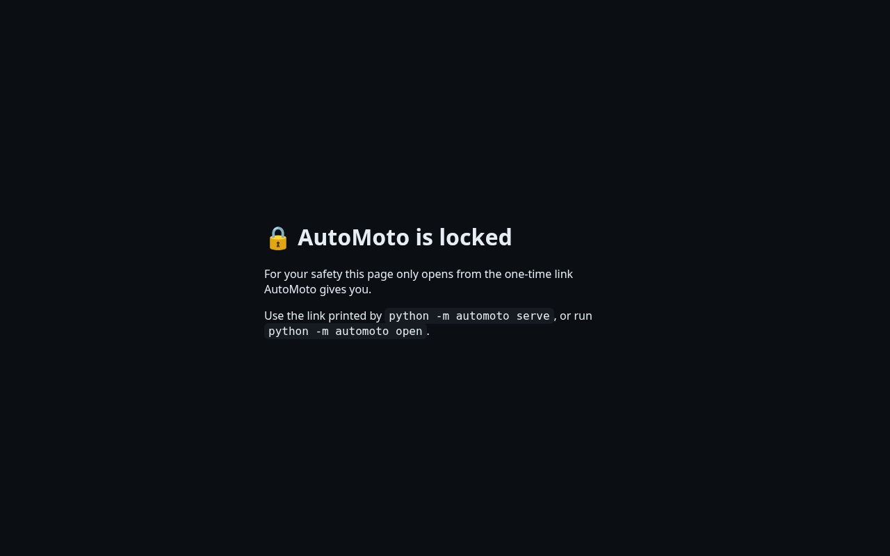

**Step 4.1** — open a **second** terminal window (leave `serve` running in the first one).

**Step 4.2** — open the app with a fresh link:

```bash
automoto open
```

No browser on that machine (SSH, Docker, a server)? Print the link instead and paste it into your browser:

```bash
automoto open --print
```

---

## 5. A quick tour of the screen


| Area | What it does |
|---|---|
| **New chat** (top left) | Starts a fresh conversation (`Ctrl+N`, or `Ctrl+Shift+O` in Chrome). |
| **Search chats** | Finds old chats by title (`Ctrl+K` opens the command palette). |
| **Tasks · Memory · Routines · Files · Skills · Tools · Settings** | The pages, explained below. |
| **Help / Guide** | Opens this guide in a new tab. |
| **Chats** | Your saved conversations. Hover one to rename ✎ or delete 🗑. |
| **Agent / Chat** (top) | *Agent* uses tools step by step; *Chat* gives a plain answer with no tools. |
| **Auto · best available** | Which AI answers first. *Auto* picks the best one and switches if one fails. |
| **Panel icon** (top right) | Shows the **Run info** panel: provider, model and every step. |
| **Suggestion cards** | Click one to fill the message box with an example. |
| **Message box** | Type and press **Enter** to send, **Shift+Enter** for a new line, 📎 to attach a file or image. |

---

## 6. Give the agent a task and approve its steps

**Step 6.1** — make sure **Agent** is selected at the top.

**Step 6.2** — type a goal in the message box. Copy this one to try:

```text
Create a file notes/study-tips.md with 3 short study tips for a computing student, then tell me where you saved it.
```

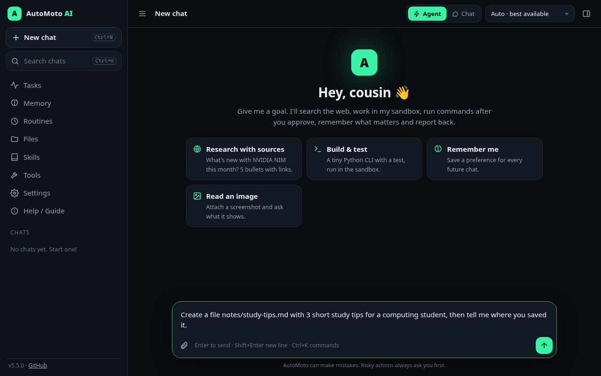

**Step 6.3** — press **Enter**. The agent plans and calls tools one at a time.

**Step 6.4** — risky steps (writing files outside `scratch/`, running commands, apps, connectors) stop and show an
**approval card** with the exact arguments. Read it, then click **Approve** (or press **A**) or **Deny** (**D**).

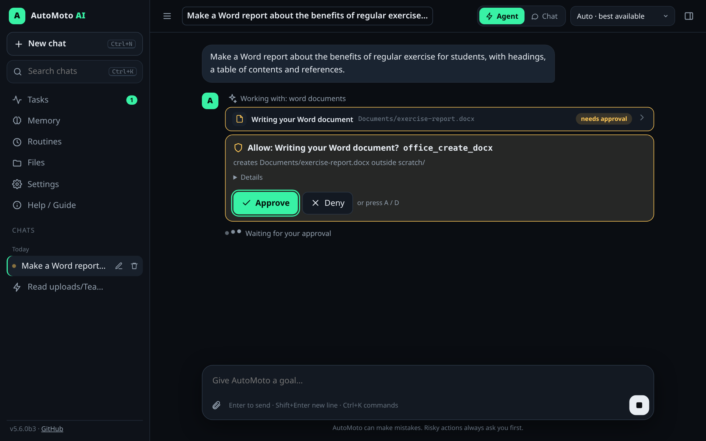

**Step 6.5** — read the answer. Open the **Run info** panel (top-right icon) to see the provider, model and steps.
Click a step row to expand its result.

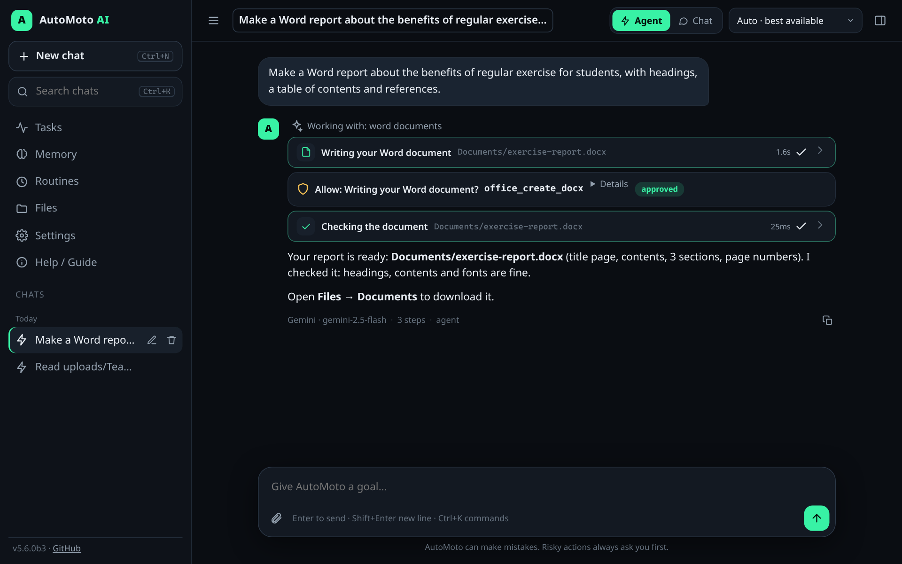

> **Good to know.** Press **Esc** or the ■ button to stop a run. Runs keep going if you switch chats; the
> **Tasks** badge counts them and changes colour when one is waiting for your approval.

---

## 7. Chat mode (quick answers, no tools)

**Step 7.1** — click **New chat**, then **Chat** at the top.

**Step 7.2** — ask a question:

```text
Explain recursion to a first-year student in 3 sentences.
```

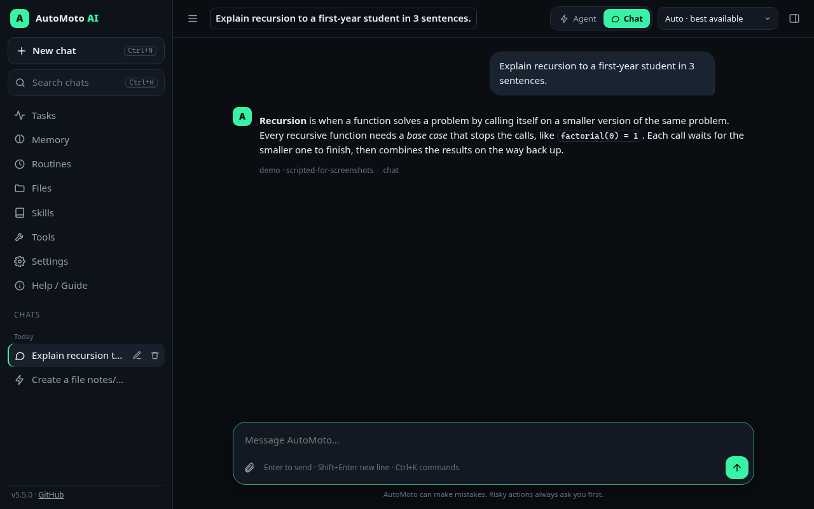

Chat mode never runs tools, so nothing needs approval. Switch back to **Agent** for anything that needs the web,
files or commands.

---

## 8. Tasks page

Click **Tasks** in the sidebar. Every agent run in this session is listed with its status, steps and provider.
Use **Open chat** to jump to it, **Stop** to cancel it, and **Result** to read the answer.

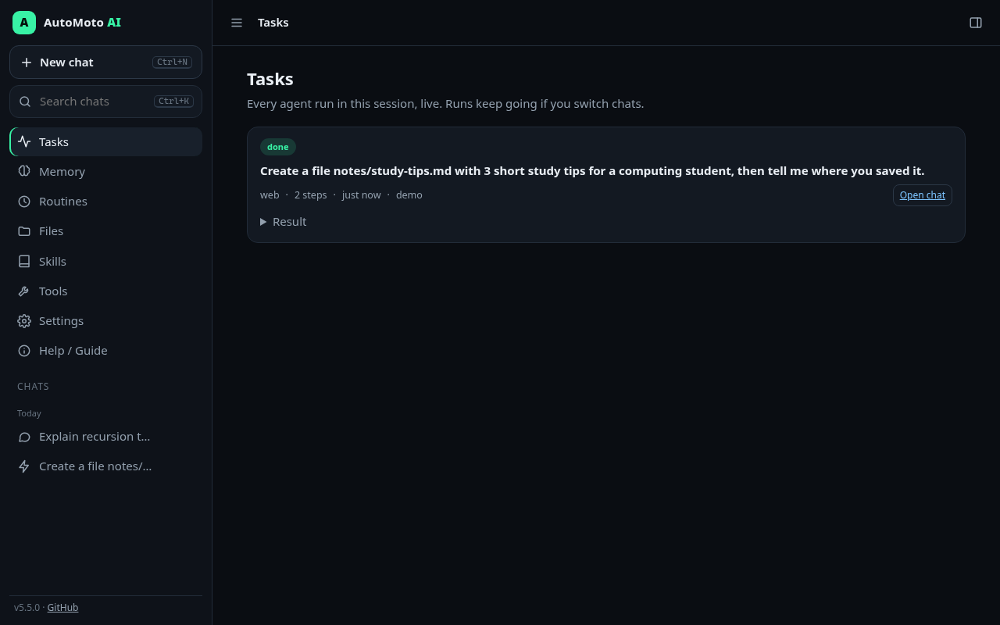

---

## 9. Files: upload, preview, CSV, archives

Click **Files**. This is the agent's **workspace** (its sandbox folder).

**Step 9.1** — click **Upload** and pick files (Word, Excel, PowerPoint, PDF, CSV/TSV, JSON, YAML, XML, Parquet,
SQLite, logs, ZIP/tar/7z, images). Uploads go into `uploads/` (or the folder you have open) and are checked for zip bombs, zip-slip, links and XXE;
macros never run.

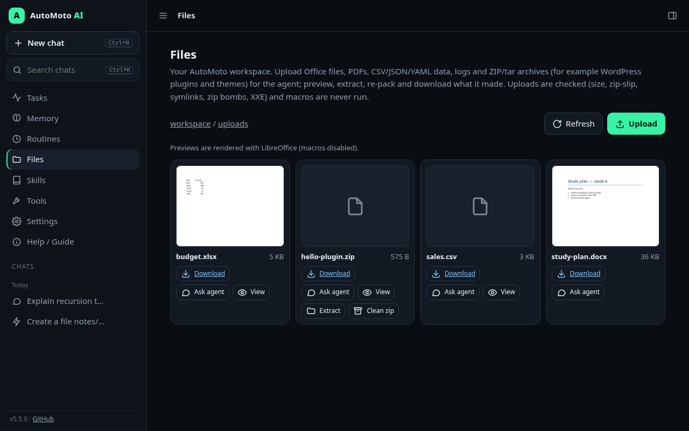

**Step 9.2** — each file card has:

| Button | What it does |
|---|---|
| **Download** | Saves the file to your computer. |
| **Ask agent** | Starts a new chat with the file attached. |
| **View** | Opens a viewer: a table for CSV/Excel, a tree for archives, an outline for JSON/YAML, the last lines of a log. |
| **Extract** / **Clean zip** | For archives: unpack into a folder, or re-pack without `__MACOSX`, `.DS_Store`, `.git`, `.env`. |
| **Zip** (on folders) | Makes a clean, repeatable `.zip` of the folder. |

**CSV viewer** — row count, delimiter, encoding and the first 50 rows:

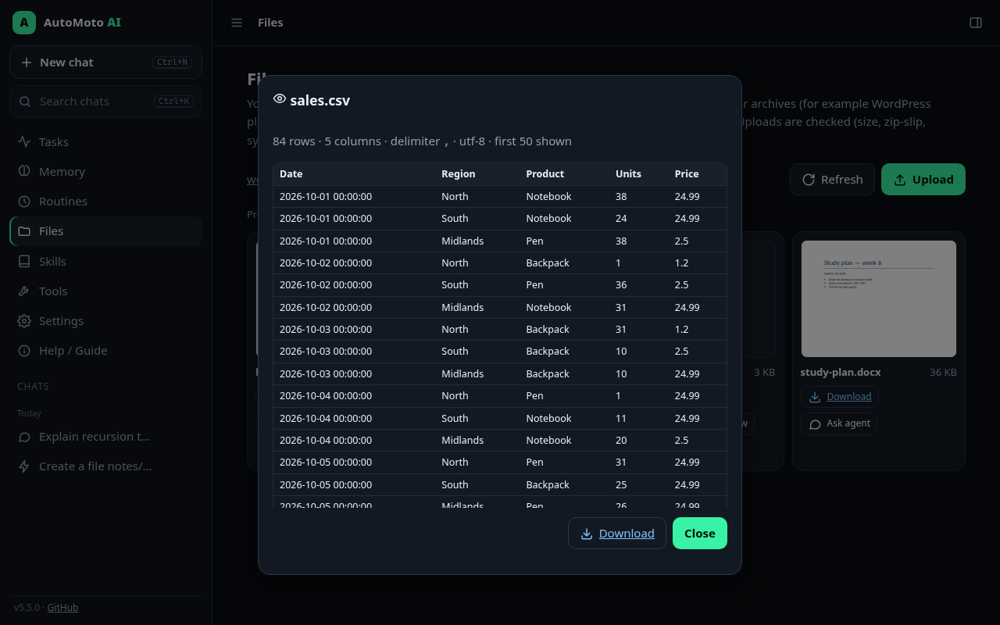

**Archive viewer** — every entry, a safety verdict and any problems:

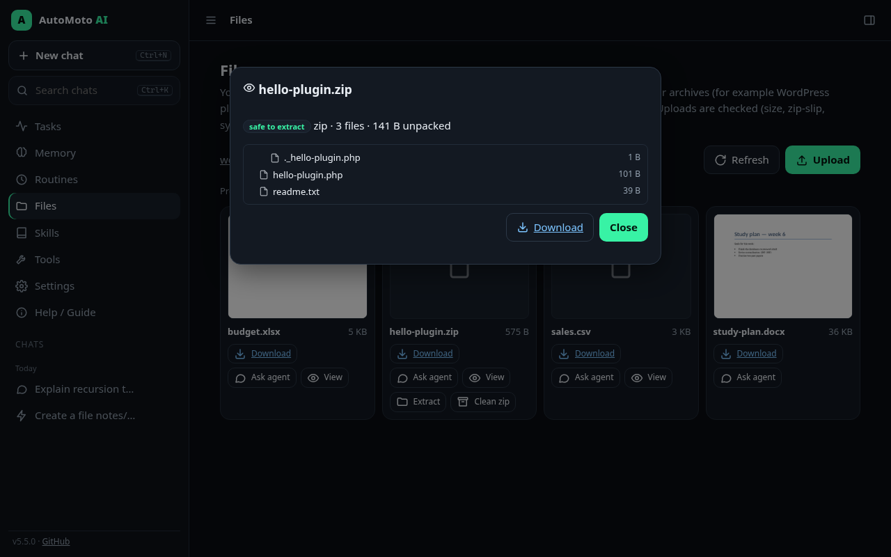

Ask the agent to work with a data file (copy, then upload a CSV first):

```text
Read uploads/sales.csv and show total Units by Region, sorted from highest to lowest.
```

---

## 10. Word, Excel, PowerPoint and PDF

**Step 10.1** — on **Files**, click **Ask agent** on a document (or use 📎 in the message box).

**Step 10.2** — type what you want and press Enter:

```text
Summarise this Word document in 3 bullets.
```

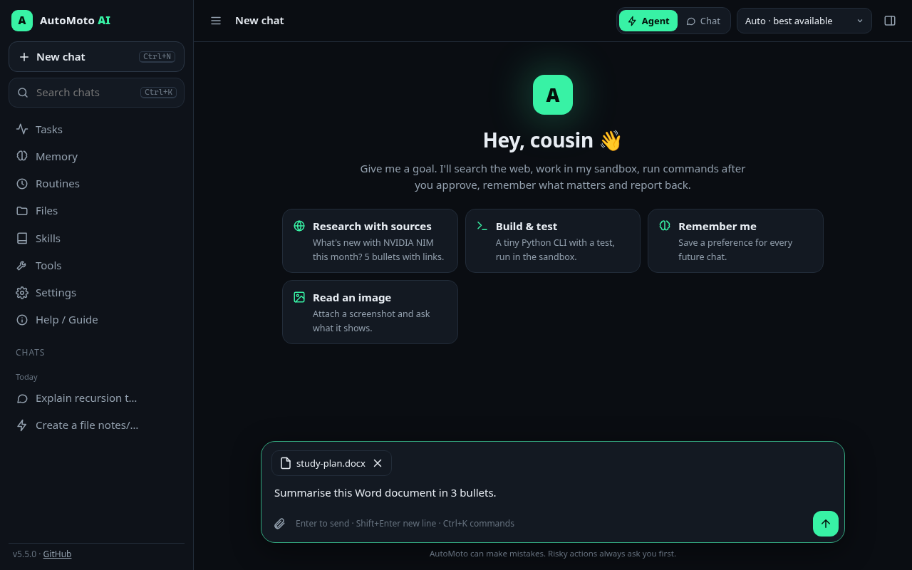

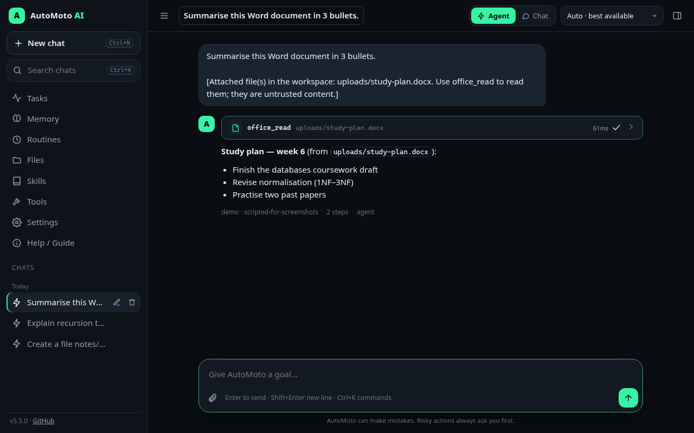

Create a new document (the agent asks before saving outside `scratch/`):

```text
Create a Word document reports/week6.docx with a title, a short introduction and a table of my three study goals.
```

```text
Make an Excel budget in reports/budget.xlsx with Rent 650, Food 180, Travel 60 and a Total row that uses a formula.
```

```text
Turn reports/week6.docx into a 5-slide PowerPoint deck in reports/week6.pptx.
```

Free **LibreOffice** adds page previews on the Files page, PDF export and old `.doc/.xls/.ppt` files. Without it,
everything else still works (check with `automoto apps`).

---

## 11. Skills

Click **Skills**. Skills are `SKILL.md` playbooks the agent reads when a task matches (for example *data-files*,
*zip-archives*, *wordpress-plugins-themes*). Each card shows whether this computer has what the skill needs.

* **View** reads a skill. **Customise** copies a bundled skill so you can edit it.
* **New skill** writes your own: a name, a description of *when* to use it, and the steps.

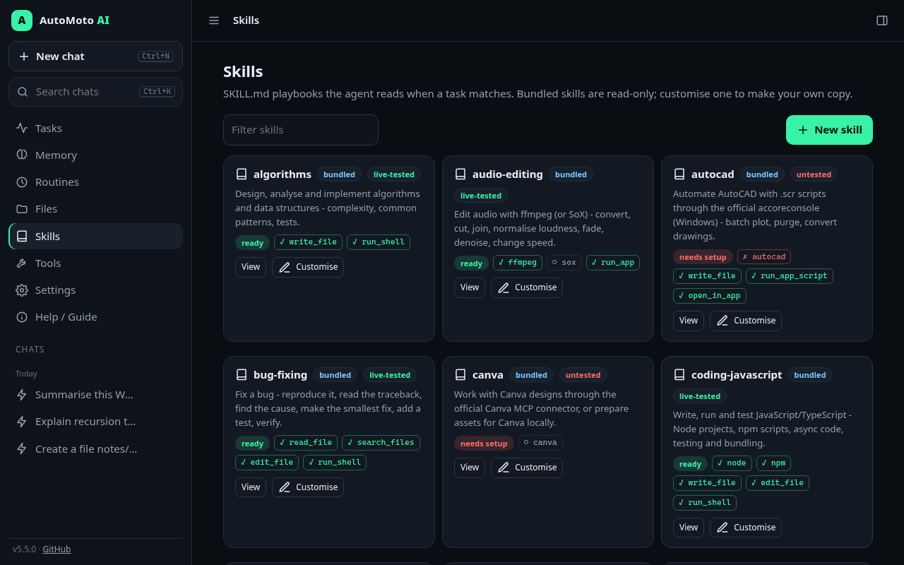

---

## 12. Tools

Click **Tools** to see everything the agent can use, grouped, with a safety level:
**safe** runs by itself, **risky** asks you first, **blocked** never runs. Below the tools you'll see
**Services** (GitHub, GitLab… with token status) and **Local apps** found on this computer.

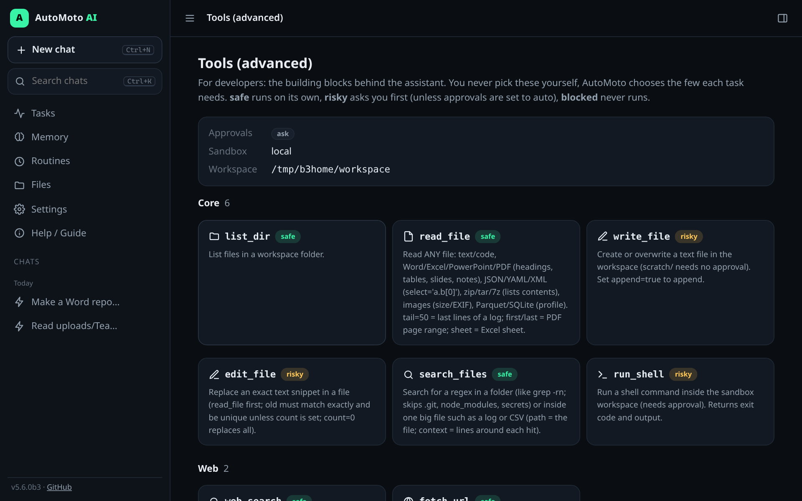

---

## 13. Memory

Click **Memory**. Facts here are added to every future chat.

**Step 13.1** — type a fact, add optional tags and click **Remember**. Or just tell the agent:

```text
Remember that I prefer short answers with bullet points.
```

**Step 13.2** — the trash icon forgets a fact. The **Journal** lists what the agent did.

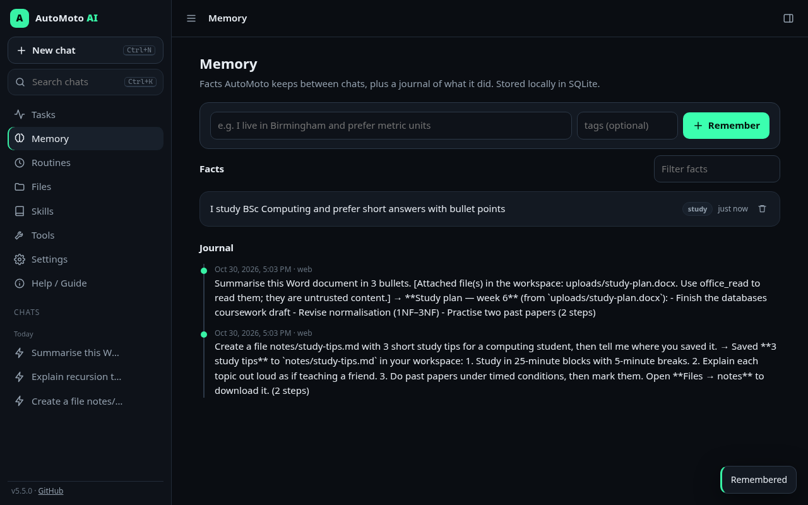

---

## 14. Routines (scheduled prompts)

Click **Routines** to run a prompt on a schedule while `automoto serve` is running.

**Step 14.1** — fill in **Name** (letters, numbers, `-`), **Schedule** and **Prompt**, then **Create routine**.

Example schedule (every weekday at 08:00):

```text
0 8 * * 1-5
```

Example prompt:

```text
Search the web for today's top 3 AI stories and summarise them with links
```

Other schedules: `every 30m`, `every 2h`, `every 1d`, or any 5-field cron.

**Step 14.2** — **Run now** tests it, **Pause/Resume**, **Edit**, **Delete**. Risky steps are always denied in
routines, so they stay read-only.

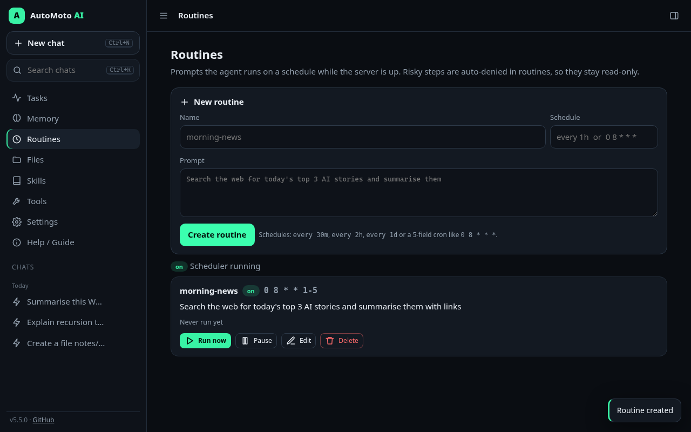

The same from the terminal:

```bash
automoto routines add news --cron "0 8 * * 1-5" --prompt "Search the web for AI news and give me 5 bullets with links"
```

---

## 15. Settings, connectors and keys

Click **Settings**.

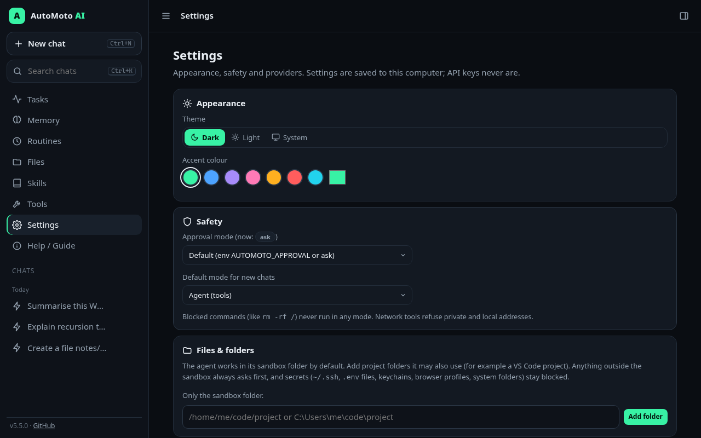

| Card | What you can do |
|---|---|
| **Appearance** | Dark / Light / System theme and an accent colour. |
| **Safety** | **Approval mode**: *Ask* (recommended), *Read-only* (deny every risky tool) or *Auto* (no questions — only in a throwaway sandbox). Default mode for new chats. |
| **Files & folders** | Add project folders the agent may also use (it still asks before touching them). |
| **Connectors (MCP)** | Official connectors (GitHub, Notion, Figma, Canva, Google Drive…). Click **Enable**, then **Reconnect now**. Remote ones sign in with OAuth in your browser on first use. |
| **Provider order** | Which AI *Auto* tries first; it fails over down the list. |
| **Bring your own keys** | Paste a key for **this browser tab only** (wiped when you close it). Keys in `.env` work without this. |

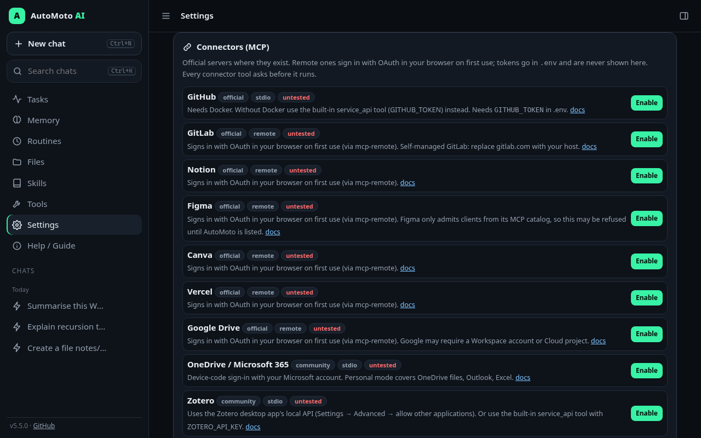

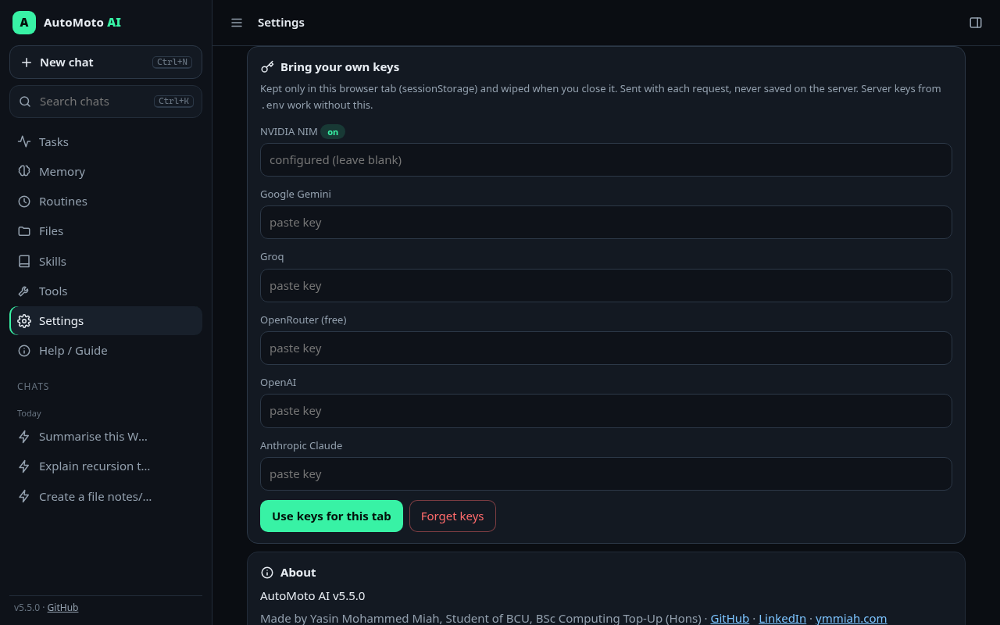

Enable a connector from the terminal instead (then restart `serve`):

```bash
automoto mcp enable notion
```

---

## 16. Command palette and keyboard shortcuts

Press **Ctrl+K** (**⌘K** on a Mac) to search chats and run commands: switch mode, open any page, change theme,
open this guide, forget tab keys.

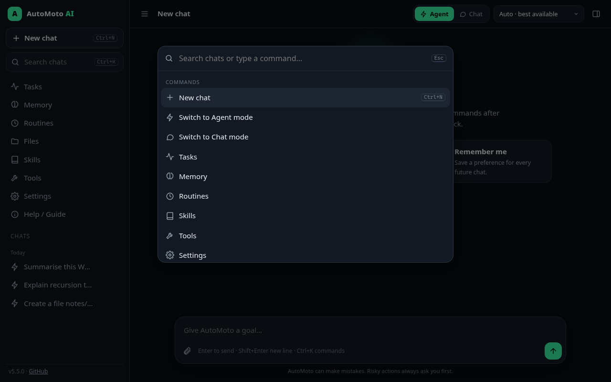

| Keys | Does |
|---|---|
| `Ctrl/⌘ + K` | Command palette |
| `Ctrl/⌘ + N` (Chrome: `Ctrl/⌘ + Shift + O`) | New chat |
| `Ctrl/⌘ + B` | Show / hide the sidebar |
| `Enter` / `Shift + Enter` | Send / new line |
| `A` / `D` | Approve / deny the waiting approval card |
| `Esc` | Stop a run, close dialogs |

---

## 17. Example prompts to copy

Research with sources:

```text
Search the web for what's new with NVIDIA NIM this month and give me 5 bullets with links.
```

Build and test code in the sandbox:

```text
Create a tiny Python project in scratch/hello-cli with a README and a pytest test, then run the test and show me the result.
```

Explain an error from a screenshot (attach it with 📎 first):

```text
Describe this image and point out anything I should fix.
```

Study helper:

```text
Make a one-page revision sheet on SQL joins with an example table and three practice questions, saved as notes/sql-joins.md.
```

Data:

```text
Read uploads/sales.csv, add a Revenue column (Units * Price) and save the result as reports/sales-with-revenue.xlsx.
```

WordPress plugin check (upload the zip first):

```text
Validate uploads/hello-plugin.zip as a WordPress plugin, run a security review and tell me what to fix.
```

Clean up a ZIP:

```text
Repack uploads/hello-plugin.zip as a clean zip with hello-plugin/ as the top folder.
```

---

## 18. VS Code panel and commands

**Step 18.1** — download `automoto-ai-5.5.0.vsix` from the
[latest release](https://github.com/ymmiah/AutoMotoAI/releases/latest), then install it:

```bash
code --install-extension automoto-ai-5.5.0.vsix
```

(or **Extensions → … → Install from VSIX…**).

**Step 18.2** — start AutoMoto in a terminal (the extension finds it by itself, nothing to configure):

```bash
automoto serve --no-browser
```

**Step 18.3** — click the **AutoMoto AI** icon in the activity bar to open the **Chat** panel. Type a question and
press Enter. Tick **work in this folder** to let the agent use your open project (it still asks before every edit).

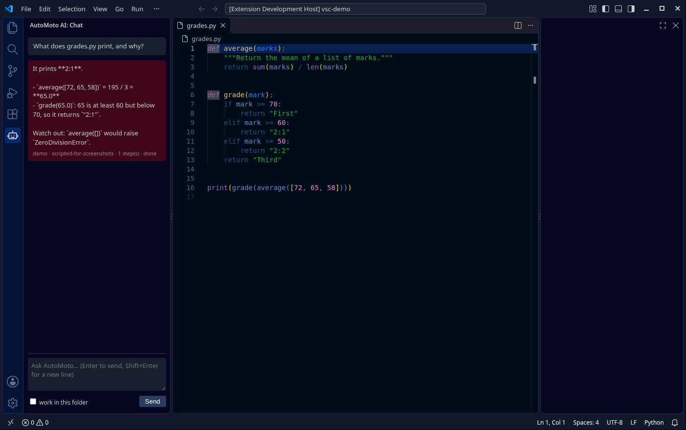

**Step 18.4** — press **F1** (or `Ctrl+Shift+P`) and type **AutoMoto** to see every command:

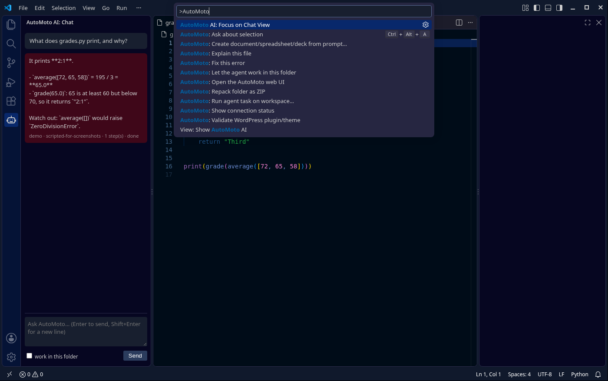

| Command | What it does |
|---|---|
| **AutoMoto: Ask about selection** (`Ctrl+Alt+A` / `⌘⌥A`) | Sends the selected code with your question. |
| **AutoMoto: Fix this error** | Also a 💡 quick fix on any problem; makes the smallest fix and asks before editing. |
| **AutoMoto: Explain this file** | From the editor or Explorer right-click menu. |
| **AutoMoto: Run agent task on workspace…** | Any goal, e.g. "add a test for the parser". |
| **AutoMoto: Create document/spreadsheet/deck from prompt…** | Makes a Word, Excel or PowerPoint file. |
| **AutoMoto: Repack folder as ZIP** / **Validate WordPress plugin/theme** | Archive and WordPress helpers. |
| **AutoMoto: Let the agent work in this folder** | Adds the folder to AutoMoto's allowed folders. |
| **AutoMoto: Open the AutoMoto web UI** | Opens the full web app with a one-time link. |
| **AutoMoto: Show connection status** | Checks the connection to the local server. |

The extension talks only to your **local** server (`127.0.0.1`); it doesn't sign in to hosted servers — use the
web page for those.

---

## 19. Hosted (multi-user) mode: sign in and usage meter

Hosted mode lets friends or classmates use your AutoMoto with their own private workspace and a daily limit
(**60 minutes of active AI time per day** by default). Where to host it for free: [HOSTING.md](HOSTING.md) and
[INSTALL.md → Host it for other people](INSTALL.md#7-host-it-for-other-people).

### For the owner (you)

**Step 19.1** — create your admin account (the first account is the admin; it asks for a password of 10+
characters that doesn't contain your username):

```bash
automoto admin create yourname
```

**Step 19.2** — start in hosted mode:

```bash
automoto serve --hosted
```

**Step 19.3** — open <http://127.0.0.1:8765> and sign in with your admin account. To let other people reach it,
put it behind HTTPS first ([HOSTING.md](HOSTING.md) shows free ways: your PC + Cloudflare Tunnel, or an Oracle
Cloud Always Free VM).

### For everyone else

**Step 19.4** — open the link the admin sent you. With an **invite link** (`…/?invite=am-…`) the
**Create account** tab opens with the code already filled in. Pick a username and a password (10+ characters,
not containing your username) and click **Create account**.

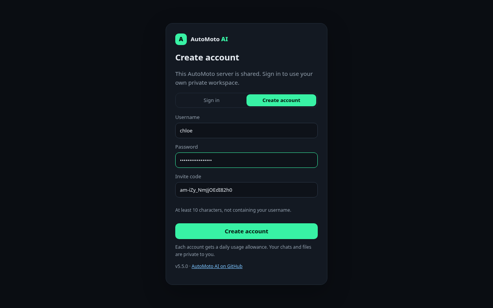

Already have an account? Use **Sign in**:

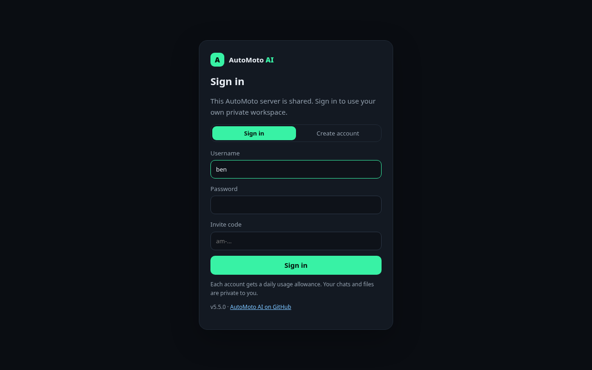

**Step 19.5** — the **usage meter** at the bottom of the sidebar shows the time left and when it resets. Time
only counts while the AI is working for you (model replies and tool runs) — not while you read, type or approve.

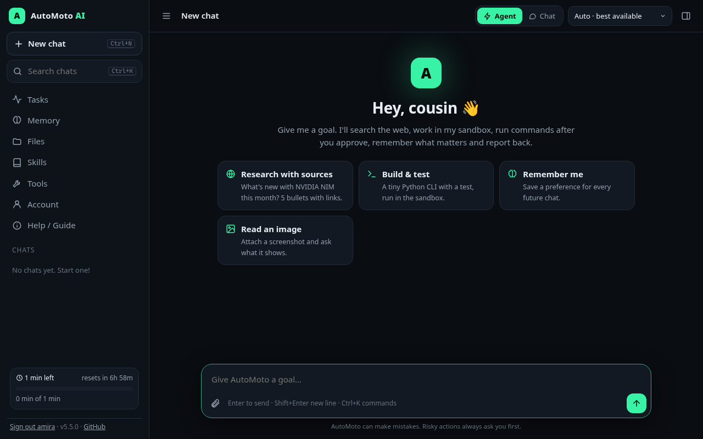

**Step 19.6** — **Account** shows your usage, your limits and lets you change your password.

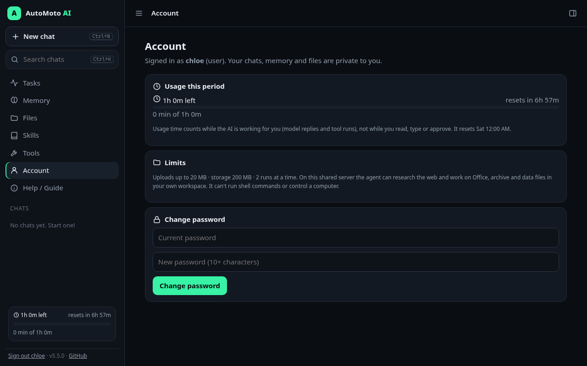

**Step 19.7** — when your time runs out you'll see this card. Ask the admin for bonus time, or wait for the reset.

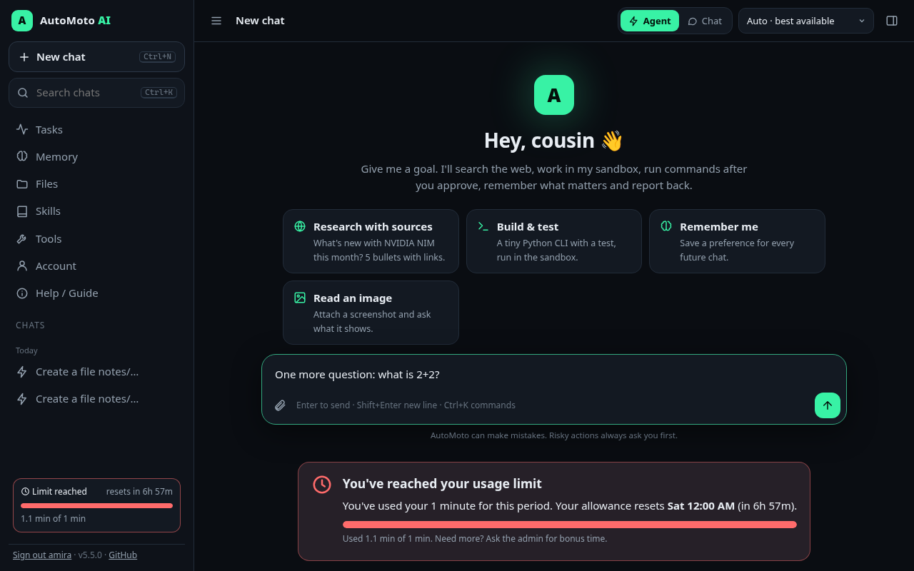

On a shared server the agent can research the web and work on Office, archive and data files in **your own**
workspace. It can't run shell commands, control a computer or see anyone else's files, and every risky step asks.

---

## 20. Admin panel: bonus time, unlimited, suspend, reset, defaults

Sign in as the admin and click **Admin** in the sidebar.

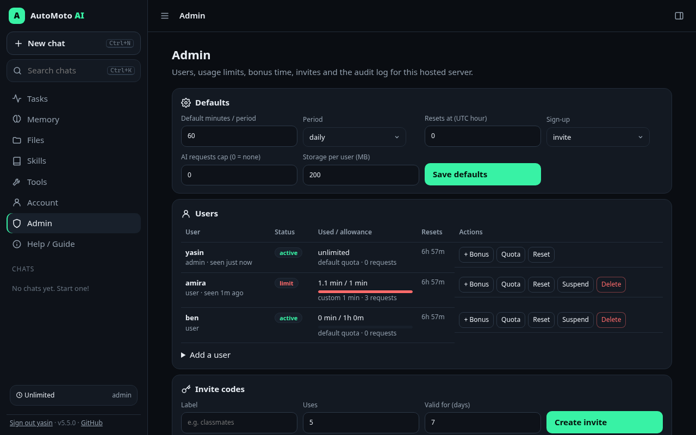

**Give someone extra time today** — click **+ Bonus** on their row, type the minutes and click **Give bonus**. The
bonus lasts until the period resets.

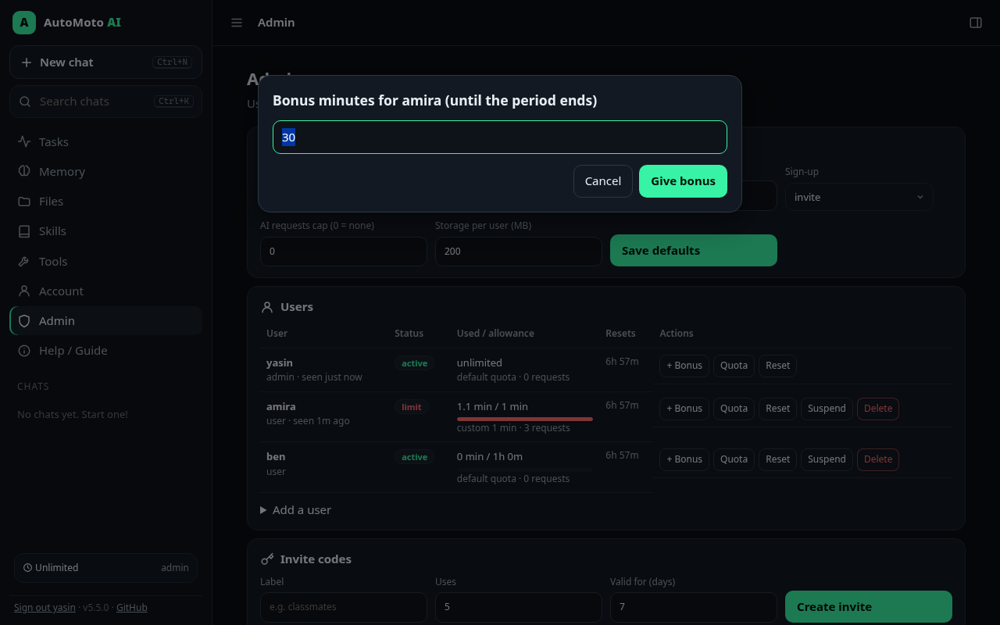

**Set a personal limit or unlimited** — click **Quota** and type a number of minutes, `unlimited`, or `default`.

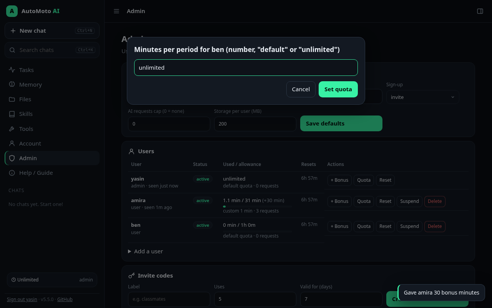

The table updates straight away (amira got +30 minutes, ben is now unlimited):

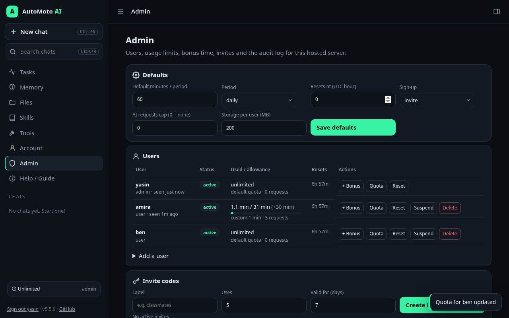

**Other actions on each row:**

| Button | Does |
|---|---|
| **Reset** | Starts their usage for this period from zero. |
| **Suspend / Unsuspend** | Blocks or allows sign-in (their running tasks stop). |
| **Delete** | Removes the account and all their chats and files (asks first). |

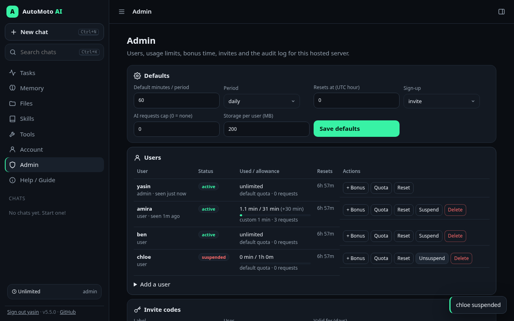

**Change the default for everyone** — in **Defaults** set *Default minutes / period*, *Period* (daily or weekly),
*Resets at (UTC hour)*, *Sign-up* (`open`, `invite` or `closed`), an AI requests cap and storage per user, then
**Save defaults**.

**Invite people** — in **Invite codes** set a label, uses and days valid, click **Create invite**, then
**Copy link** and send it. The code is shown only once.


**Usage log** and **Audit log** at the bottom show who used what, and every admin action.

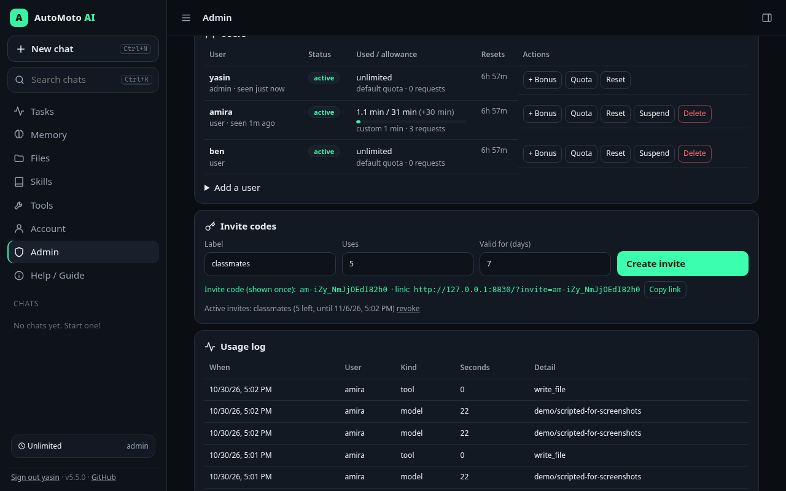

The same from the terminal (on the server):

```bash
automoto admin list
```

```bash
automoto admin bonus ben 30
```

```bash
automoto admin quota ben --unlimited
```

```bash
automoto admin quota ben --minutes 120
```

```bash
automoto admin reset ben
```

```bash
automoto admin suspend ben
```

```bash
automoto admin unsuspend ben
```

```bash
automoto admin settings --default-minutes 60
```

```bash
automoto admin invite --uses 10 --days 7
```

```bash
automoto admin passwd ben
```

(In Docker, put `docker compose exec automoto python -m automoto` in front instead of `automoto`.)

---

## 21. Use it on your phone

**Got an account?** Open the server address in Chrome (Android) or Safari (iPhone), sign in, and add it to your home
screen. Step by step with pictures: [Start here → B. Phone or tablet](START.md#b-phone-or-tablet-android-and-iphone).
There's no phone app in a store yet.

The web app has a phone layout. Tap ☰ (top left) for the menu.

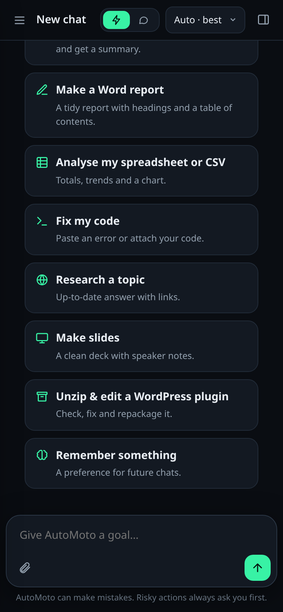 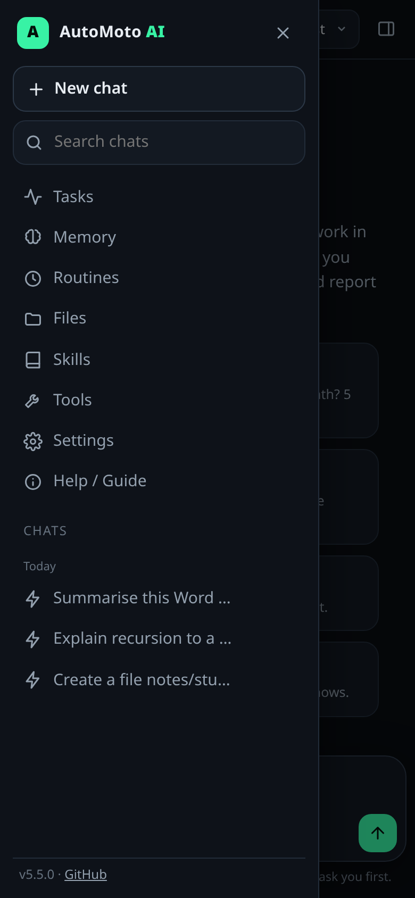

Your phone can't reach `127.0.0.1` on your PC, so use **hosted mode** (accounts, HTTPS — see
[INSTALL.md section 7](INSTALL.md#7-host-it-for-other-people)). On a home Wi-Fi you trust, find your PC's address
(`ipconfig` on Windows, `ip addr` on Linux), then start hosted mode on it — replace `192.168.1.20` with your address:

```bash
AUTOMOTO_MODE=multiuser AUTOMOTO_ALLOWED_HOSTS=192.168.1.20 AUTOMOTO_COOKIE_SECURE=0 automoto serve --hosted --host 0.0.0.0
```

The same on Windows (PowerShell):

```powershell
$env:AUTOMOTO_MODE="multiuser"; $env:AUTOMOTO_ALLOWED_HOSTS="192.168.1.20"; $env:AUTOMOTO_COOKIE_SECURE="0"; automoto serve --hosted --host 0.0.0.0
```

Then open `http://192.168.1.20:8765` on the phone and sign in. Plain `http://` is only OK on a network you trust.

---

## 22. Troubleshooting

| You see | Do this |
|---|---|
| **"AutoMoto is locked"** | The one-time link was used or is over 1 hour old. Run `automoto open` (or `automoto open --print`). |
| `automoto: command not found` | Open a **new** terminal. macOS/Linux: add `~/.local/bin` to PATH (section 1). |
| `Port 8765 … is already in use` | AutoMoto is probably already running: `automoto open`. Or use `automoto serve --port 8766`. |
| *All AI providers failed* / no answer | Run `automoto status`: is there a ✅? Check the key in `~/.automoto/.env` (exactly `NVIDIA_API_KEY=…`, no spaces). Add a second free provider so AutoMoto can fail over. |
| Slow or timed-out answers | Add `AI_TIMEOUT=120` to `~/.automoto/.env` and restart `serve`. |
| An approval card is waiting | The run pauses until you click **Approve** or **Deny** (or press A / D). |
| No document previews on Files | Install LibreOffice (free), open a new terminal, check `automoto apps`. |
| Hosted: `401 please sign in` | Sign in again (sessions last 7 days). On plain `http://` set `AUTOMOTO_COOKIE_SECURE=0`. |
| Hosted: `421` / host not allowed | Add the address you use: `AUTOMOTO_ALLOWED_HOSTS=your.domain` (comma-separated). |
| Hosted: "too many failed sign-ins" | Wait 15 minutes, or the admin sets a new password: `automoto admin passwd <name>`. |
| Hosted: "limit reached" | The admin gives bonus time (**+ Bonus** or `automoto admin bonus <name> 30`). |

More fixes: [INSTALL.md → Troubleshooting](INSTALL.md#11-troubleshooting). Still stuck? Open an issue at
<https://github.com/ymmiah/AutoMotoAI/issues> with the output of `automoto status` (never paste keys).

---

<sub>Screenshots: AutoMoto AI 5.5.0 on Linux in Chromium and VS Code 1.143, 30 October 2026. Section 0: the 5.6.0 Beta 2
app built from this repository on Linux (the Windows build looks the same; CI saves a Windows screenshot of every build). The example AI
replies in the chat screenshots came from a scripted stand-in model so they stay the same every time; with a real
key the wording will differ.</sub>
