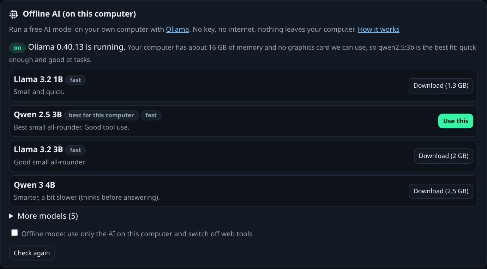

# Offline AI: use AutoMoto with no internet and no key

> **⚠️ Beta.** Offline AI is new and is in testing on `main` (after 5.6.0 Beta 3). If your
> version has no **Offline AI** card in Settings, you need a newer build.

AutoMoto can use a free AI model that runs **on your own computer**. You don't need an AI key.
Once the model is downloaded you don't need the internet either, and your chats and files never
leave your computer.

It uses **[Ollama](https://ollama.com)**, a free app that runs AI models.

## What you need

* A Windows, Mac or Linux computer (phones can't do this).
* At least **8 GB of memory** for a good experience. 4 GB works with a tiny model.
* About **2–5 GB of free disk space** for the model.
* The internet **once**, to download Ollama and the model.

Local models are smaller than online ones, so they are a bit **slower and less clever**. They
are fine for everyday chats, writing, summing up your files and simple tasks.

## Set it up in 4 steps

**1. Install Ollama.** Go to [ollama.com/download](https://ollama.com/download), download it
for your computer and install it like any other app.

* **Windows / Mac:** open the installer and click through. Ollama then runs in the background
  (look for the llama icon by the clock or in the menu bar).
* **Linux:** copy this into a terminal:

  ```bash
  curl -fsSL https://ollama.com/install.sh | sh
  ```

**2. Open AutoMoto, then go to Settings → Offline AI (on this computer).**
It checks your computer and shows the models that fit. The one marked
**Best for this computer** is the one to get.



**3. Click Download** next to that model. It takes a few minutes (about 2 GB). You can keep
using AutoMoto while it downloads. When it's done, AutoMoto starts using it.

**4. (Optional) Turn on Offline mode.** Tick **Offline mode** on the same card. Now AutoMoto:

* uses **only** the AI on your computer (never an online AI, even if you added keys), and
* switches off everything that needs the internet: web search, opening web pages,
  downloading files, online services and connectors.

Untick it to go back to normal.

That's it. Start a new chat and ask something.

## Which model should I pick?

AutoMoto picks for you, but here is the idea:

| Your computer | Good model | Download |
|---|---|---|
| 4 GB memory | `qwen2.5:1.5b` | 1 GB |
| 8–16 GB memory (most laptops) | `qwen2.5:3b` (or `llama3.2:3b`) | 2 GB |
| 32 GB memory, or a graphics card with 6 GB+ | `qwen2.5:7b` | 4.7 GB |
| Graphics card with 12 GB+ | `qwen3:14b` | 9.3 GB |
| Mac with Apple chip, 16 GB | `qwen2.5:7b` | 4.7 GB |

All of these can **use tools**, so they can read your files and make documents, not just chat.

## The same thing from the command line

```bash
automoto local                    # what fits this computer, and what Ollama has
automoto local pull qwen2.5:3b    # download it and start using it
automoto local offline            # Offline mode on   (automoto local online = off)
automoto local off                # stop using Ollama
```

Or in your `.env` file:

```bash
OLLAMA_MODEL=qwen2.5:3b     # use this Ollama model
AUTOMOTO_OFFLINE=1          # Offline mode
# OLLAMA_HOST=http://127.0.0.1:11434   # only if Ollama runs somewhere else on your network
```

## Other local AI apps (llama.cpp, LM Studio, Jan…)

Any app that offers an **OpenAI-compatible server** on your computer works too:

```bash
LOCAL_LLM_URL=http://127.0.0.1:8080/v1   # llama.cpp `llama-server` (LM Studio: http://127.0.0.1:1234/v1)
LOCAL_LLM_MODEL=qwen2.5-3b-instruct       # the model name that app shows
```

For safety, AutoMoto only talks to local servers on **your computer or your home network**
(addresses like `127.0.0.1`, `localhost` or `192.168.x.x`), never a server on the internet.

## Something's not working?

| What you see | What to do |
|---|---|
| "Ollama isn't running" | Open the Ollama app (Windows/Mac), or run `ollama serve` (Linux). Then press **Check again**. |
| The Download button is greyed out | Same: Ollama has to be running first. |
| "Offline mode is on, but no AI is set up" | Download a model in Settings → Offline AI, or untick Offline mode. |
| Answers are very slow | Pick a smaller model (`qwen2.5:1.5b`). Close big apps. The first answer is always slowest while the model loads. |
| It gives up halfway through a long task | Small models find long tasks hard. Split it into smaller steps, or use a bigger model. |
| It says it can't search the web | That's Offline mode. Untick it if you want web search. |

More help: [Start here](START.md) · [Install guide](INSTALL.md)
