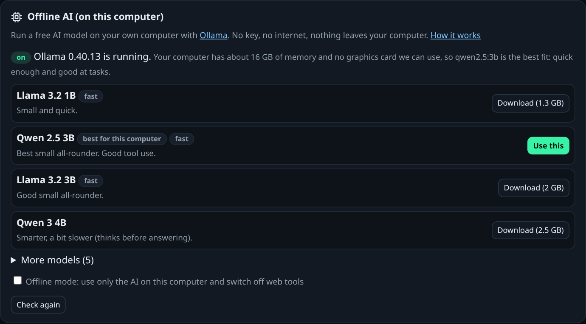

# Offline AI: use AutoMoto with no internet and no key

> **⚠️ Beta.** These newer controls are being tested on `fix/chat-scroll-offline-navigation-files` and may not yet be part of the installed Microsoft Store version. If your Settings page lacks **Offline AI**, update to a build containing the feature.

AutoMoto can use a free AI model that runs **on your own computer**. You don't need an AI key.
Once the model is downloaded you don't need the internet either, and your chats and files never
leave your computer.

It uses **[Ollama](https://ollama.com)**, a free local inference runtime. AutoMoto needs that runtime installed on the PC (a one-time dependency), but it can start an installed copy and download models through Settings. No paid API or cloud account is required for local inference.

## What you need

* A Windows, Mac or Linux computer (phones can't do this).
* At least **8 GB of memory** for a good experience. 4 GB works with a tiny model.
* About **2–5 GB of free disk space** for the model.
* The internet **once**, to download Ollama and the model.

Local models are smaller than online ones, so they are a bit **slower and less clever**. They
are fine for everyday chats, writing, summing up your files and simple tasks.

## Set it up in 4 steps

**1. Install Ollama.** Go to [ollama.com/download](https://ollama.com/download), download it
for your computer and install it like any other app.

* **Windows / Mac:** open the installer and click through. Ollama then runs in the background
  (look for the llama icon by the clock or in the menu bar).
* **Linux:** copy this into a terminal:

  ```bash
  curl -fsSL https://ollama.com/install.sh | sh
  ```

**2. Open AutoMoto, then go to Settings → Offline AI (on this computer).**
It checks your computer and shows recommended models **and models already downloaded**. If Ollama is installed but not running, click **Start local AI**. Choose a model marked **Recommended**, or download another supported Ollama model by name.



**3. Click Download** next to a model. The size and time depend on the model and connection. After downloading, click **Use model**, then **Test** for a small real inference check. You can choose another installed model later without downloading it again.

**4. (Optional) Turn on Offline mode.** Tick **Offline mode** on the same card. Now AutoMoto:

* uses **only** the AI on your computer (never an online AI, even if you added keys), and
* switches off everything that needs the internet: web search, opening web pages,
  downloading files, online services and connectors.

Untick it or click **Use cloud AI / server providers** to return to available cloud models. If `AUTOMOTO_OFFLINE=1` is defined in the environment, remove or change that server setting first; the UI cannot override it.

That's it. Start a new chat and ask something.

## Which model should I pick?

AutoMoto picks for you (Settings marks it **Recommended**), and if the model you picked isn't downloaded it
quietly uses the best one you *do* have instead of failing. All of these are free, open-weights models from the
[Ollama library](https://ollama.com/library):

| Your computer | Good model | Download |
|---|---|---|
| 4 GB memory | `qwen2.5:1.5b` or `qwen3.5:0.8b` | 1–1.3 GB |
| 8 GB memory (most laptops) | `qwen2.5:3b` (fastest) or `llama3.2:3b` | About 2 GB |
| 16 GB memory, or a graphics card with 6 GB+ | `qwen3.5:4b` (reads images too) | About 4 GB |
| 32 GB memory, a graphics card with 12 GB+, or a 16 GB Mac | `qwen3.5:9b`, `gemma4:12b` or `deepseek-r1:8b` | 5–8 GB |
| A graphics card with 16–24 GB | `gpt-oss:20b` or `qwen3.5:27b` | 14–20 GB |

Qwen, Llama, Mistral, Gemma **4**, DeepSeek R1 and gpt-oss can call AutoMoto's tools directly. **Gemma 3** can't
(Ollama lists no tool calling for it), so AutoMoto uses its slower text protocol with it automatically. You can
also type any other Ollama model name into **Download by name**.

**Thinking models** (Qwen 3 / 3.5, DeepSeek R1, gpt-oss) normally "think" for a long time before each step, which
is very slow on a laptop CPU. AutoMoto turns thinking off (gpt-oss: down to *low*). Set `LOCAL_AI_THINK=1` to
let them think.

**Context window:** Ollama's own default (2–4 thousand tokens on most PCs) is smaller than AutoMoto's
instructions and tool list, which made small models "forget" how to work. AutoMoto now asks for **8,192 tokens**
on every request (`LOCAL_AI_CONTEXT=16384` for long documents if you have the memory; never more than the model
supports).

## The same thing from the command line

```bash
automoto local                    # what fits this computer, and what Ollama has
automoto local pull qwen2.5:3b    # download it and start using it
automoto local offline            # Offline mode on   (automoto local online = off)
automoto local off                # stop using Ollama
```

Or in your `.env` file:

```bash
OLLAMA_MODEL=qwen2.5:3b     # use this Ollama model
AUTOMOTO_OFFLINE=1          # Offline mode
# OLLAMA_HOST=http://127.0.0.1:11434   # only if Ollama runs somewhere else on your network
```

## Other local AI apps (llama.cpp, LM Studio, Jan…)

Any app that offers an **OpenAI-compatible server** on your computer works too:

```bash
LOCAL_LLM_URL=http://127.0.0.1:8080/v1   # llama.cpp `llama-server` (LM Studio: http://127.0.0.1:1234/v1)
LOCAL_LLM_MODEL=qwen2.5-3b-instruct       # the model name that app shows
```

For safety, AutoMoto only talks to local servers on **your computer or your home network**
(addresses like `127.0.0.1`, `localhost` or `192.168.x.x`), never a server on the internet.

## Something's not working?

| What you see | What to do |
|---|---|
| "Ollama isn't running" | Click **Start local AI** if installed; otherwise install from [ollama.com/download](https://ollama.com/download). |
| The Download button is greyed out | Start Ollama locally first. Network access is needed to download a new model, but not to use a downloaded model. |
| "Offline mode is on, but no AI is set up" | Download a model in Settings → Offline AI, or untick Offline mode. |
| "… is not downloaded on this computer yet" | Download it in Settings → Offline AI, or pick one with **Use model**. It works straight after the download finishes. |
| "Ollama isn't running" in a chat | AutoMoto starts an installed Ollama by itself once; if that fails, click **Start local AI** or open Ollama from the Start menu. |
| "timed out" | The model is too big for this computer. Pick a smaller one, or raise `LOCAL_AI_TIMEOUT` (seconds, default 600). |
| Answers are very slow | Pick a smaller model (`qwen2.5:3b` or `qwen2.5:1.5b`). Close big apps. The first answer is always slowest while the model loads; **Test** loads it ahead of time. |
| The Windows app has no **Offline AI** card | Your local engine is older than this feature. Update the app, then click **Install the local engine** again to update the engine too. |
| It gives up halfway through a long task | Small models find long tasks hard. Split it into smaller steps, or use a bigger model. |
| It says it can't search the web | That's Offline mode. Untick it if you want web search. |

**Switch between local PC mode and cloud/server accounts:** in the new Windows desktop build, use the top-bar **Local / Server** link or the app menu **Switch Local / Cloud / Server**. This returns to the mode-choice screen; it does not merge your local and hosted chat history automatically.

**Microsoft Store:** [AutoMoto AI Windows listing](https://apps.microsoft.com/detail/9n9j7flssfg8?hl=en-GB&gl=GB). Store releases may lag behind source changes.

More help: [Start here](START.md) · [Install guide](INSTALL.md)
