# Start here: pick your device

> **⚠️ Beta.** This guide is for **AutoMoto AI 5.6.0 Beta 2**, a test version
> ([download page](https://github.com/ymmiah/AutoMotoAI/releases/tag/v5.6.0-beta.2)). Things may still change or break.
> Want the stable version instead? Use **5.5.0** ([release](https://github.com/ymmiah/AutoMotoAI/releases/tag/v5.5.0))
> and the [install guide](INSTALL.md). 5.5.0 has no Windows app.

Every code box has a **copy button** in its top-right corner. Click it, then paste with **Ctrl+V** (Mac: **⌘+V**).

## Which one are you?

| I have… | Go to |
|---|---|
| A **Windows 10 or 11** PC or laptop | [A. Windows PC](#a-windows-pc) |
| An **Android phone** or an **iPhone / iPad** | [B. Phone or tablet](#b-phone-or-tablet-android-and-iphone) |
| A **Mac** or a **Linux** computer | [C. Mac or Linux](#c-mac-or-linux) |
| **VS Code** (the code editor) | [D. VS Code](#d-vs-code) |
| More than one of these | [E. One account on every device](#e-one-account-on-every-device) |
| I run the server for other people (Yasin, teachers, admins) | [F. For admins](#f-for-admins-running-the-account-server) |
| Something isn't working | [G. Help, it's not working](#g-help-its-not-working) |

**Two words you'll see:**

* **Account**: a username and password on an **AutoMoto server** that someone runs (often your admin, teacher or
  Yasin). Your chats and files are saved **on that server**, so you see them on every device. You don't need your own
  AI key.
* **Local mode**: AutoMoto runs **only on your own computer**, with no account. You need your own free AI key.
  Phones can't use Local mode.

---

## A. Windows PC

You need Windows 10 or 11 (64-bit) and the internet.

### A1. Download the app

1. Open the **[5.6.0 Beta 2 download page](https://github.com/ymmiah/AutoMotoAI/releases/tag/v5.6.0-beta.2)**.
2. Scroll down to **Assets**.
3. Click **`AutoMoto-AI_5.6.0-beta.2_x64-setup.exe`** to download it. This is the one most people want. It installs just for you
   and doesn't need an admin password.

   *(The other installer, `AutoMoto-AI_5.6.0-beta.2_x64_en-US.msi`, is for school or work IT and needs admin rights.)*

   If **Edge** says the file *isn't commonly downloaded*, click **⋯ → Keep → Show more → Keep anyway**.
   New programs get this message until enough people have downloaded them.

4. **Optional safety check:** make sure the download wasn't changed on the way. Open **PowerShell** (Start menu → type
   *PowerShell* → open it) and paste:

   ```powershell
   (Get-FileHash "$HOME\Downloads\AutoMoto-AI_5.6.0-beta.2_x64-setup.exe").Hash
   ```

   It should print `8DD3298AFF2F00D486B5C47FF12B1E764D40FDBD555BEBA2CC53A52EB6656DCA`
   (the same as in `SHA256SUMS.txt` on the download page).

### A2. Install it (and the blue "Windows protected your PC" box)

1. Double-click the file you downloaded (in your **Downloads** folder).
2. A blue box may say **"Windows protected your PC"**. This is expected:
   * Click **More info**.
   * Click **Run anyway**.

   **Why does it say that?** Windows shows this for programs that aren't **code-signed** yet. Signing costs money
   or needs an approval that this free beta doesn't have yet. It doesn't mean a virus was found. If you're not sure,
   do the safety check in A1 first, or ask an adult or your IT person.
3. The installer opens. Click **Next** / **Install**, then **Finish**. It takes a few seconds. If the PC doesn't
   have **WebView2** (Windows 11 always has it), the installer downloads it for you.
4. Open **AutoMoto AI** from the Start menu. The window title says **AutoMoto AI (Beta)**.

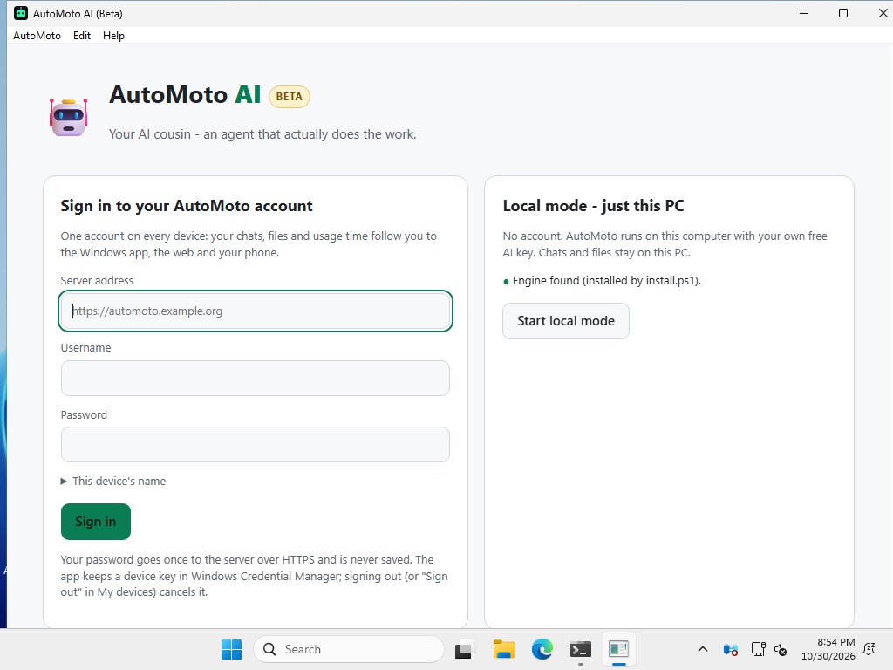

### A3. Choose: account or Local mode

The first screen has two boxes. **Pick one:**

* Someone gave you a **server address, username and password** → do **A4 (account)**.
* You want to use AutoMoto **only on this PC** with your own free AI key → do **A5 (Local mode)**.

### A4. Sign in to your account

1. **Server address**: type what your admin gave you, e.g. `https://automoto.example.org`.
   It must start with `https://`. (Plain `http://` only works for a server on the same PC.)
2. **Username** and **Password**: type yours.
3. Optional: click **This device's name** and type a name you'll recognise, like *Sam's laptop*.
4. Click **Sign in**.

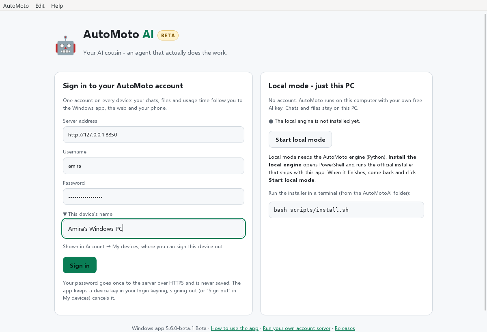

You're in. Your chats are in the list on the left.

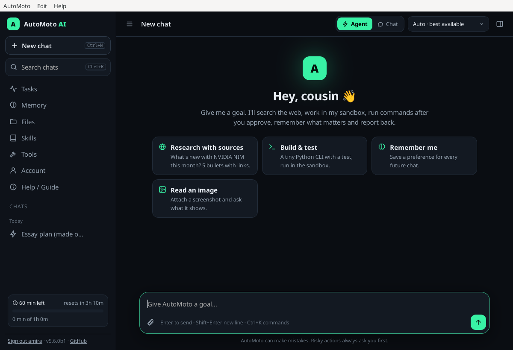

* Your password is sent once to the server and **never saved** on the PC.
* The app keeps a **device key** in Windows Credential Manager, so next time it opens straight into your account.
* You **don't need an AI key**. The server has one.
* Start chatting: jump to **[A6](#a6-your-first-chat)**.

### A5. Local mode (no account, just this PC)

Local mode needs the **AutoMoto engine** on your PC, and the engine needs **Python 3.10 or newer**.
The app **doesn't** install Python for you. Here is exactly what happens:

**Step 1: get Python** (skip this if you already have it). Open **PowerShell** and paste:

```powershell
winget install -e --id Python.Python.3.12
```

Wait until it says it's done, then **close PowerShell**.
(No `winget`? Get Python from <https://www.python.org/downloads/> and tick **"Add python.exe to PATH"**.)

**Step 2: install the engine.** In the app, click **Install the local engine**. A **PowerShell window** opens and
runs AutoMoto's official installer, which comes inside the app:

* It finds Python. (If it can't, it tells you to do Step 1 and stops.)
* It downloads the **5.6.0b2** engine from GitHub and checks its fingerprint (SHA-256) before installing it.
* It installs into `%LOCALAPPDATA%\automoto-ai`, without admin rights.
* It may ask whether to install **optional tools** (LibreOffice, PDF tools, 7-Zip, PHP) with winget.
  Type **y** for yes or **n** for no. You can say no.
* It creates your private settings file `%USERPROFILE%\.automoto\.env`.
* When it says **Done**, close that PowerShell window.

**Step 3: add a free AI key.** AutoMoto needs one AI key in Local mode.

1. Go to <https://build.nvidia.com>, sign in (it's free) and click **Get API Key**. Copy the key (it starts with
   `nvapi-`). *Kids: ask an adult to help with this step.*
2. Open your settings file. Paste this into PowerShell:

   ```powershell
   notepad "$env:USERPROFILE\.automoto\.env"
   ```

3. Add this line, with **your** key instead of the example, then **save** (Ctrl+S) and close Notepad:

   ```text
   NVIDIA_API_KEY=nvapi-paste-your-key-here
   ```

Other free keys (Gemini, Groq, OpenRouter) work too: [INSTALL.md → free AI key](INSTALL.md#2-get-a-free-ai-key).
**Never** share your key or paste it into a chat.

**Step 4: start.** Click **Start local mode**. AutoMoto starts on your PC and opens. When you close the window,
AutoMoto stops too. If you added the key while AutoMoto was running, close the app and open it again.

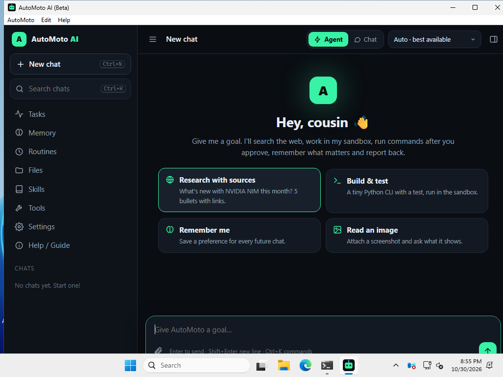

### A6. Your first chat

1. Click in the box at the bottom that says **Give AutoMoto a goal…**
2. Type something, e.g. *Explain photosynthesis in 3 short sentences*, and press **Enter**.
3. If AutoMoto wants to do something risky (like run a command), it shows **Approve / Deny**. Read it, then
   choose.

More about every page: [GUI guide](GUI-GUIDE.md) (from section 5).

### A7. Switching, updates and signing out

* **Back to the first screen** (switch between account and Local mode): menu **AutoMoto → Sign-in screen /
  switch mode**, or press **Ctrl+Shift+H**.
* **Updates:** the beta app checks for a newer **beta** when it starts and asks *"… is available. Install it
  now?"*. Click **Yes** and it restarts by itself. To check yourself: **AutoMoto → Check for updates…**. Every
  update is signed, and the app refuses one that isn't.
* **Sign out on this PC:** **AutoMoto → Sign out of this device**.

### A8. Uninstall

1. Open **Settings → Apps → Installed apps**.
2. Find **AutoMoto AI** → **⋯** → **Uninstall**.

Your account and its chats stay on the server. If you used Local mode, your chats stay in `%USERPROFILE%\.automoto`.
To also remove the local engine, paste this into PowerShell **before** uninstalling the app:

```powershell
powershell -ExecutionPolicy Bypass -File "$env:LOCALAPPDATA\AutoMoto AI\resources\install.ps1" -Uninstall
```

---

## B. Phone or tablet (Android and iPhone)

There's **no phone app in a store yet** (and no Android or iPhone app download). On a phone you use AutoMoto
**in the web browser**, signed in to your **account**. You need the **server address**, **username** and
**password** from your admin.

### B1. Sign in

1. Open **Chrome** (Android) or **Safari** (iPhone/iPad).
2. Type the **server address** in the address bar, e.g. `https://automoto.example.org`, and go.
3. Type your **username** and **password**, then tap **Sign in**.
   *(Got an invite link instead? Open it, tap **Create account**, pick a username and password.)*

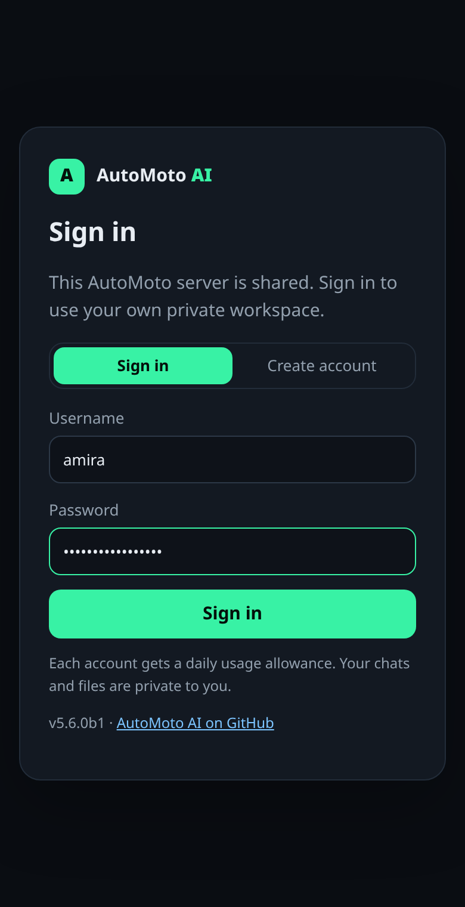 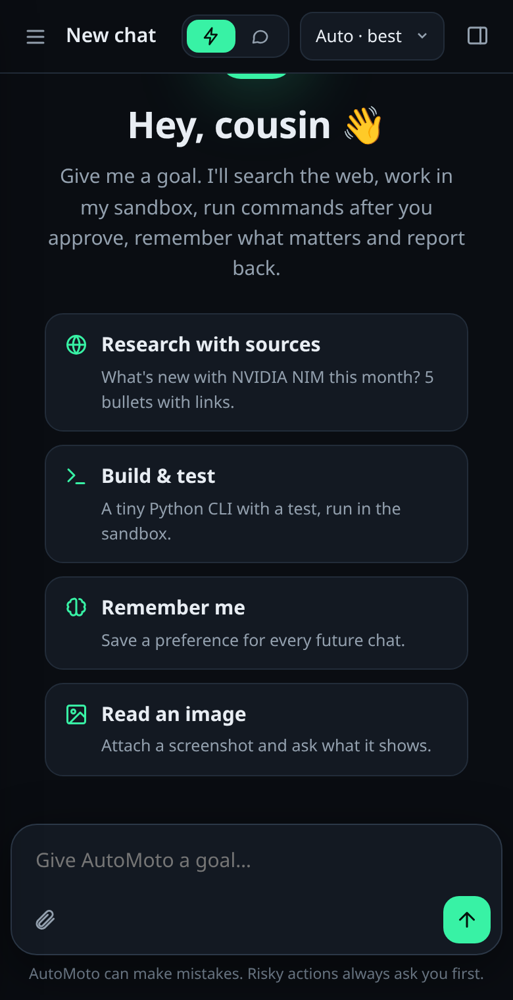

4. Tap **☰** (top left) for the menu. Your chats from the PC are there too.

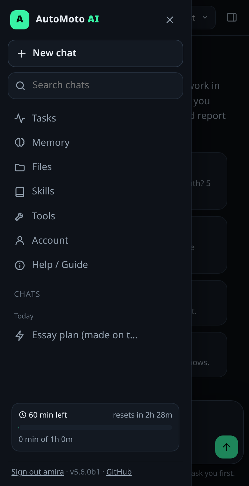 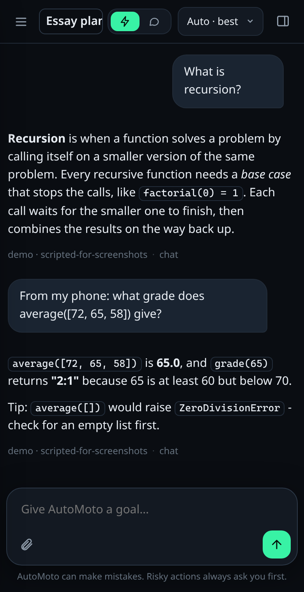

### B2. Put it on your home screen (like an app)

**Android (Chrome):**

1. With AutoMoto open, tap **⋮** (three dots, top right).
2. Tap **Add to Home screen**. (Some phones say **Install app** or **Create shortcut**.)
3. Tap **Add**.

**iPhone or iPad (Safari):**

1. With AutoMoto open, tap the **Share** button (a square with an arrow pointing up). On newer iPhones it may be
   inside the **⋯** menu.
2. Scroll down and tap **Add to Home Screen**.
3. Tap **Add**.

Now there's an AutoMoto icon on your home screen. It opens the website in the browser. It isn't a real app, and it
needs the internet.

### B3. What's different on a phone

* **Same account, same chats and files** as the PC and the Windows app.
* Your **usage time** (e.g. 60 minutes a day) is shared by all your devices. **Account** shows what's left.
* On the shared server the agent can search the web and work on Office, data and archive files. It **can't run
  commands or control a computer**. That's for Local mode on a PC.
* Uploads up to 20 MB each (your admin can change this).

---

## C. Mac or Linux

The desktop **app is only released for Windows** so far. On a Mac or Linux you have two choices:

* **Use your account in the browser.** Open the server address in Safari, Chrome or Firefox and sign in, like on a
  phone ([B1](#b1-sign-in)).
* **Install AutoMoto on the computer** (like Local mode) and use it in your browser:

1. Open **Terminal**.
2. Get Python and Git. On a **Mac** (needs [Homebrew](https://brew.sh)):

   ```bash
   brew install python@3.12 git
   ```

   On **Ubuntu / Debian Linux**:

   ```bash
   sudo apt install python3 python3-venv git
   ```

3. Download AutoMoto:

   ```bash
   git clone https://github.com/ymmiah/AutoMotoAI
   ```

4. Go into the folder:

   ```bash
   cd AutoMotoAI
   ```

5. Install the **beta** engine (leave out `--version 5.6.0b2` to get stable 5.5.0):

   ```bash
   ./scripts/install.sh --version 5.6.0b2
   ```

6. Add your free AI key (see [A5 Step 3](#a5-local-mode-no-account-just-this-pc) for getting one). Open the
   settings file. On a **Mac**:

   ```bash
   open -e ~/.automoto/.env
   ```

   On **Linux**:

   ```bash
   nano ~/.automoto/.env
   ```

   Add `NVIDIA_API_KEY=nvapi-…` with your key and save.
7. **Open a new Terminal window** (so it finds the new `automoto` command), then start AutoMoto:

   ```bash
   automoto serve
   ```

   Your browser opens AutoMoto by itself. Stop it with **Ctrl+C** in Terminal.

Every option (Fedora, Arch, Apple Silicon, start at login, Docker): [INSTALL.md](INSTALL.md).

---

## D. VS Code

The VS Code panel talks to AutoMoto **running on the same computer** (Local mode or `automoto serve`). It doesn't
sign in to a shared account server.

1. Install AutoMoto on the computer first: Windows → [A5](#a5-local-mode-no-account-just-this-pc) Steps 1–3 (or
   [INSTALL.md](INSTALL.md#3-windows-1011)), Mac/Linux → [C](#c-mac-or-linux).
2. Download **`automoto-ai-5.6.0-beta.2.vsix`** from the
   [beta download page](https://github.com/ymmiah/AutoMotoAI/releases/tag/v5.6.0-beta.2) (Assets).
3. Install it. In a terminal, in your **Downloads** folder:

   ```bash
   code --install-extension automoto-ai-5.6.0-beta.2.vsix
   ```

   (Or in VS Code: **Extensions → ⋯ → Install from VSIX…** and pick the file.)
4. Start AutoMoto (Local mode in the Windows app, or `automoto serve`), then click the **AutoMoto AI** icon in VS
   Code's left bar.

More: [GUI guide § 18](GUI-GUIDE.md#18-vs-code-panel-and-commands).

---

## E. One account on every device

**How it works:** your chats, files, memory and usage time are stored **on the AutoMoto server**, not on the
device. Every device that signs in with the **same username** sees the same things. A chat started on the PC
shows up on the phone. A question asked on the phone shows up in the Windows app (press **Ctrl+R** to refresh).

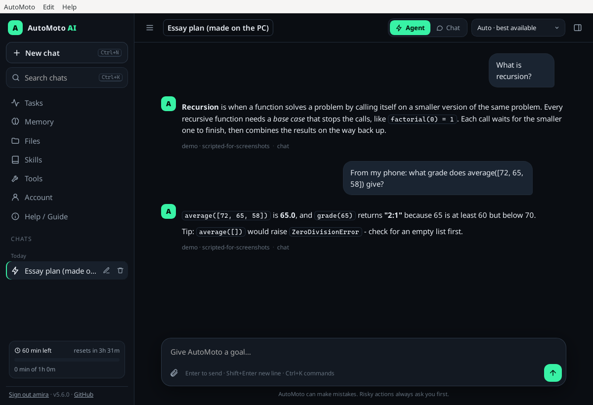

**See every device signed in:** open **Account** (left menu) → **My devices**. *this one* is the device you're
holding.

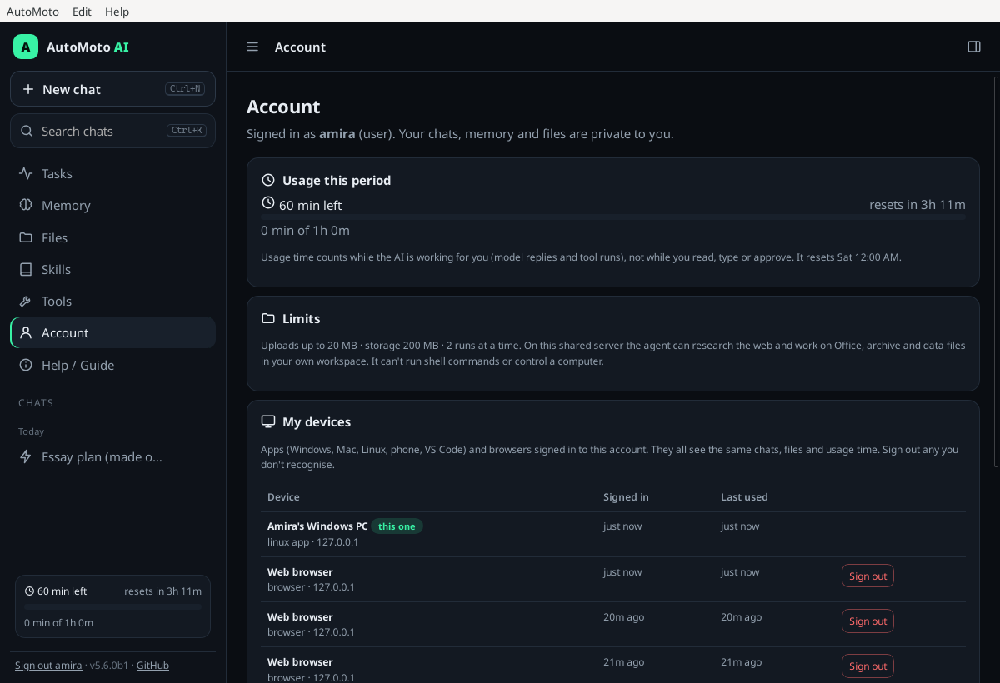

On a phone it's the same page: **☰ → Account**, scroll to **My devices**.

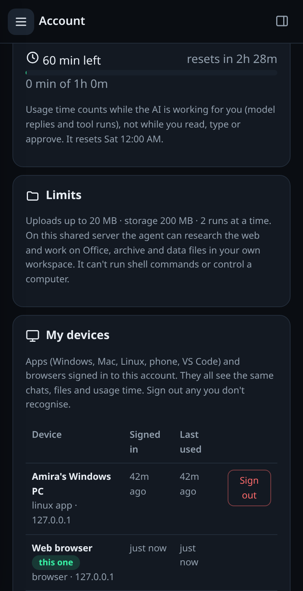

**Lost a phone or laptop?**

1. On any other device, sign in and open **Account → My devices**.
2. Find the lost device and click **Sign out**. It's signed out straight away.
3. To be extra safe, **change your password** (also on the Account page). That signs out **every** other device.

Local mode is different: it keeps everything on that one PC and isn't part of your account.

---

## F. For admins (running the account server)

People can only sign in once someone runs an **AutoMoto account server** (hosted mode). Free ways to run one, step
by step: **[HOSTING.md](HOSTING.md)** and [INSTALL.md § 7](INSTALL.md#7-host-it-for-other-people). Use HTTPS
(Cloudflare Tunnel or Caddy), because the Windows app refuses `http://` servers that aren't on the same PC.

> **Run 5.6.0b2 on the server.** The Windows app's sign-in uses features that are new in 5.6.0. A 5.5.0 server
> works in browsers but **not** in the app.

**Make accounts** (on the server, where `AUTOMOTO_DATA_DIR` points to the server's data). Create a user (it asks
for a password twice):

```bash
automoto admin create amira
```

Or make an **invite code** that one person can use within 7 days to create their own account:

```bash
automoto admin invite --uses 1 --days 7
```

Send them the link `https://<your-server>/?invite=<code>`. In the browser: **Admin → Invite codes → Create invite**.

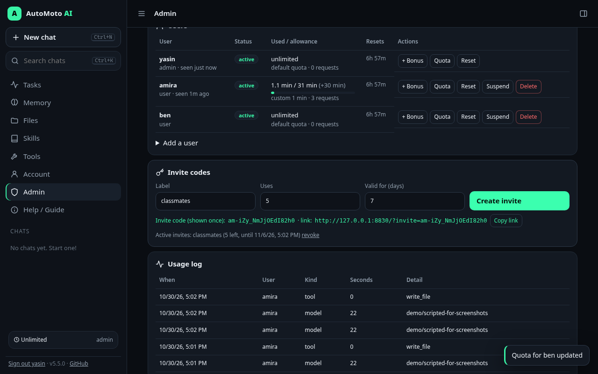

**Give more time:** 30 extra minutes for today's period:

```bash
automoto admin bonus amira 30
```

Change someone's daily allowance to 2 hours:

```bash
automoto admin quota amira --minutes 120
```

Or in the browser: **Admin → Users → + Bonus / Quota** ([GUI guide § 20](GUI-GUIDE.md#20-admin-panel-bonus-time-unlimited-suspend-reset-defaults)).

**Sign out someone's lost device:** **Admin → Signed-in apps → Sign out**.

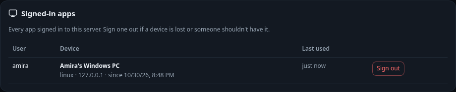

**Put your server address into the Windows app** so people don't have to type it. Set the repository variable once
(GitHub CLI, signed in as the repo owner):

```bash
gh variable set AUTOMOTO_DEFAULT_SERVER --body "https://automoto.example.org" --repo ymmiah/AutoMotoAI
```

The **next** app build (the next beta tag) has it filled in. People can still change it. Already-released installers
keep an empty box.

---

## G. Help, it's not working

**Windows app**

| Problem | Fix |
|---|---|
| "Windows protected your PC" | **More info → Run anyway** ([why](#a2-install-it-and-the-blue-windows-protected-your-pc-box)). |
| *"Use https:// - your password and device key must not travel unencrypted"* | The address starts with `http://`. Use the `https://` address from your admin (try it in a browser first). |
| *"Network error …"* or *"the server answered …"* | Check the address and your internet. Open the address in a browser: you should see the AutoMoto sign-in page. |
| *"wrong username or password"* | Check Caps Lock. Ask your admin to reset it (`automoto admin passwd <name>`). |
| *"That address is not an AutoMoto account server (hosted mode is off, or it is older than 5.6)"* | Sign-in works in a browser but not in the app: the server needs 5.6.0b2. Ask the admin ([F](#f-for-admins-running-the-account-server)). |
| *"too many sign-in attempts - wait 15 minutes"* | Wait 15 minutes, then try again carefully. |
| *"this device was signed out - sign in again"* | Someone signed this PC out in **My devices**, or the password changed. Sign in again. |
| *The local engine is not installed yet* | Do [A5](#a5-local-mode-no-account-just-this-pc) Steps 1–2. |
| The engine install says Python is missing | Do A5 Step 1, **close** PowerShell, then click **Install the local engine** again. |
| Local mode opens, but the AI doesn't answer | Add a key (A5 Step 3), then close and reopen the app. Menu **Help → Open the local engine log** shows what happened. |
| *"NVIDIA NIM: the key was rejected (403)"* | The key is wrong or expired. Make a new one at <https://build.nvidia.com> (**Get API Key**), replace the `NVIDIA_API_KEY=` line in your settings file (A5 Step 3), then close and reopen the app. |
| *"model not available to this key (404) - tried …"* (or `nim: NotFoundError: Error code: 404`) | The key works, but NVIDIA doesn't let it use those models. 5.6.0-beta.2 tries other models by itself. To see which ones answer, open **Settings → Test keys** (or run `automoto doctor`), then put the suggested line, e.g. `NIM_MODEL=openai/gpt-oss-20b`, in your settings file. |
| *"503 = provider busy … retried 2 times"* (or `InternalServerError: Error code: 503`) | The AI company's servers are overloaded. It's not your key. AutoMoto already waited and tried other models. Try again in a minute. |
| *"All AI providers failed"* with only one key | Add a second **free** key so one company can't stop you: Gemini (<https://aistudio.google.com/apikey>, `GEMINI_API_KEY=`) or Groq (<https://console.groq.com/keys>, `GROQ_API_KEY=`). |
| Local mode opens an AutoMoto you started yourself | If something already runs on port 8765 (e.g. `automoto serve`), the app opens that one instead of starting a second. |
| Stuck on a page | **Ctrl+R** reloads. **Ctrl+Shift+H** goes back to the first screen. |

**Phone**

| Problem | Fix |
|---|---|
| The page doesn't open | Check the address (with `https://`) and your internet. Your phone can't open `127.0.0.1`; that's only the PC itself. |
| *"Usage limit reached …"* | Your time for today is used up, on all devices together. Wait for the reset (shown on **Account**) or ask the admin for bonus time. |
| Signed out by itself | Someone signed this device out in **My devices**, or the password changed. Sign in again. |
| No "Add to Home Screen" | Android: use **Chrome**. iPhone: use **Safari**, then look in the **Share** menu (or the **⋯** menu). |

**Mac / Linux**

| Problem | Fix |
|---|---|
| `automoto: command not found` | Open a **new** Terminal window. Or run `~/.local/bin/automoto serve`. |
| *Python 3.10 or newer is needed* | Install Python (step 2 in [C](#c-mac-or-linux)), then run the installer again. |
| The browser didn't open | Run `automoto open --print` and open the link it prints. |

More fixes: [INSTALL.md § 11](INSTALL.md#11-troubleshooting) and [GUI guide § 22](GUI-GUIDE.md#22-troubleshooting).
Still stuck? Open an issue: <https://github.com/ymmiah/AutoMotoAI/issues> (never paste keys or passwords there).
